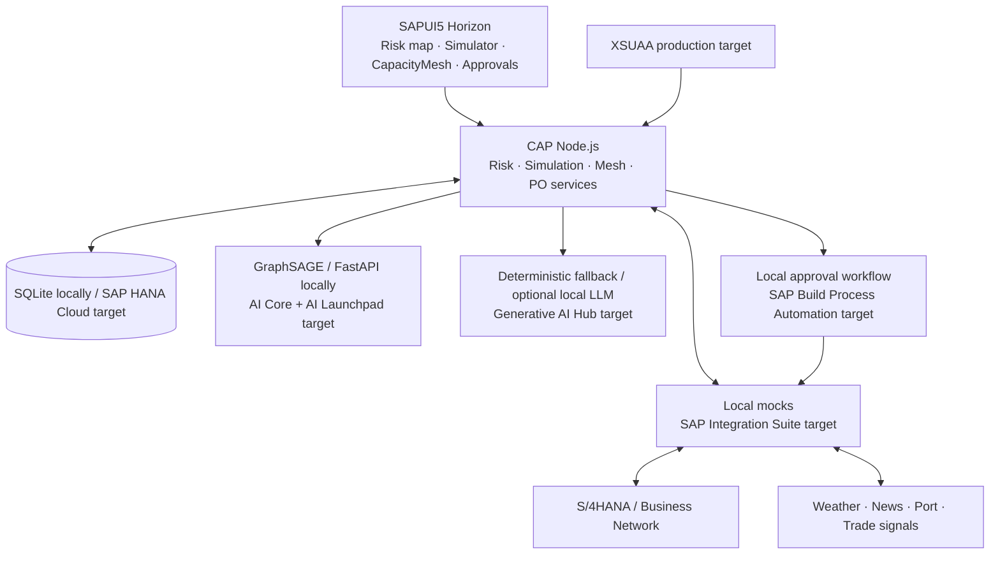

# ShockTwin

**See the supply shock coming. Borrow the capacity to survive it.**

SAP HackFest 2026 · Resilient Supply Chains · RV University, Bengaluru · 23 October 2026

[](https://github.com/francisreubenr-rvu/ShockTwin/actions/workflows/ci.yml)


Additional badge placeholder: SAP BTP deployment status will be added only after a verified deployment.

## The problem

A buyer can know its immediate suppliers while missing the upstream plant they share. About two-thirds of disruptions originate at tier 2 or deeper, while average response to a new disruption is about two weeks (McKinsey; McKinsey Supply Chain Risk Survey 2024). ShockTwin turns a reviewable upstream-risk hypothesis into a simulated consequence, a ranked capacity response and a human-approved procurement draft.

## What it does

**Detect** proposes hidden supplier links using a real GraphSAGE link predictor trained on synthetic data, with confidence, evidence and confirm/reject controls. **Simulate** propagates a shock through material dependencies and compares inventory, affected orders and revenue exposure with and without a switch. **Respond** uses CapacityMesh to rank spare capacity, draft a PO through an adapter and send it to an authorized human inbox.

CapacityMesh is ShockTwin's response step. No autonomous purchase approval is permitted.

Demo GIF placeholder: `docs/screenshots/demo.gif` — replace with a recording of the real tested workflow. Real app captures are stored in `docs/screenshots/` for the pitch deck.

> **Illustrative demo:** all company, supplier, inventory, order, signal, price and capacity records are illustrative. Synthetic model metrics do not establish real-network accuracy. A local approved mock PO does not place a real order in SAP.

## Architecture



The frontend is authored as freestyle SAPUI5 using locally served OpenUI5 and Horizon, with a Fiori launchpad-style sandbox. SAP Build Apps is a separate low-code runtime; an optional companion can consume these APIs, but this app is not claimed to be generated by Build Apps. See [PRD](docs/PRD.md) and [Architecture](docs/ARCHITECTURE.md) for the implementation contract and cloud boundaries.

## Tech stack

| Area         | Local demo                                                  | SAP production target                                 |
| ------------ | ----------------------------------------------------------- | ----------------------------------------------------- |
| UI           | SAPUI5/OpenUI5, Horizon, graph/chart views                  | SAPUI5/Fiori; optional Build Apps companion [VERIFY]  |
| Services     | CAP 8, Node.js 20.19+, REST/OData                           | CAP on BTP Cloud Foundry                              |
| Data         | SQLite and reproducible seed                                | HANA Cloud relational/graph/vector [VERIFY]           |
| ML           | Python 3.11+, PyTorch Geometric GraphSAGE, FastAPI          | AI Core / AI Launchpad [VERIFY]                       |
| Explanations | Deterministic template; optional OpenAI-compatible endpoint | Generative AI Hub [VERIFY]                            |
| Integration  | S/4HANA OData mock, mock signals                            | Integration Suite, S/4HANA, Business Network [VERIFY] |
| Approvals    | Local state machine and audit trail                         | Build Process Automation [VERIFY]                     |
| Security     | Development identity, tenant-scoped handlers                | XSUAA role collections [VERIFY]                       |
| Quality      | Unit/API/model smoke tests, Playwright E2E, ESLint/Prettier | GitHub Actions and staged integration verification    |

## Repository structure

```text
ShockTwin/                    # Repository root; no second nested checkout required
├── app/
│   ├── risk-map/             # Graph, concentration and link review
│   ├── simulator/            # Shock inputs and inventory comparison
│   ├── capacitymesh/         # Listings, ranking and draft action
│   └── approvals/            # Human decision and audit history
├── srv/                      # Four CAP domain services (.cds and .js)
├── db/                       # CDS schema and illustrative CSV seed data
├── ml/                       # Features, training, prediction, FastAPI, saved model
├── integrations/
│   ├── s4hana-mock/          # PurchaseOrder, Supplier, Material, Inventory OData
│   └── signals/              # Illustrative news/weather and optional live adapter
├── workflow/                 # Approval definition and local executable fallback
├── scripts/                  # Seed, development launcher and demo replay
├── tests/                    # Domain/API, ML smoke and browser E2E
├── docs/                     # PRD, architecture, presentation spec, screenshots
├── presentations/            # PPTX, PDF, PNG previews, fonts and build source
├── .github/workflows/ci.yml
├── mta.yaml
├── xs-security.json
├── package.json
├── .env.example
├── DEMO.md
└── README.md
```

## Prerequisites

For the **local demo**, install Node.js 20.19 or newer with npm, Python 3.11 or newer with pip/venv, and Git. Have enough disk space and network access for the initial PyTorch/OpenUI5 dependency download. The development runtime uses local assets after installation; no SAP account, paid API key or external LLM is required.

The production application router requires Node.js 22 or 24; use Node 24 for the complete Cloud Foundry target.

For **SAP deployment**, additionally obtain a SAP BTP trial/subaccount with the required service entitlements, a Cloud Foundry organization/space, Cloud Foundry CLI with the MultiApps deploy plugin, Cloud MTA Build Tool (`mbt`), and CDS development kit (`npm install -g @sap/cds-dk`). HANA Cloud, XSUAA, Integration Suite, Build Process Automation, AI Core/AI Launchpad and Generative AI Hub availability, quotas and API authorizations depend on account/region/plan [VERIFY]. A trial account alone does not guarantee all services.

## Setup and local run

```bash
git clone https://github.com/francisreubenr-rvu/ShockTwin.git
cd ShockTwin
npm install
npm run seed
npm run dev
```

`npm install` installs Node dependencies and prepares the local Python ML environment through the repository setup script. `npm run seed` resets only the local Illustrative dataset and prepares the saved synthetic-model fixture. Startup launches CAP on **4004**, the S/4HANA mock on **4005**, signals on **4006** and ML on **8000**. Open **http://localhost:4004**; the launcher attempts to open the sandbox automatically on desktop systems.

For headless machines or a browser you manage yourself:

```bash
NO_OPEN=1 npm run dev
```

Copy `.env.example` to `.env` only if you need to change defaults or enable optional integrations. Keep `.env` out of Git. Leave LLM credentials unset to use deterministic explanations. Stop the launcher with Ctrl+C; it terminates its child services.

If installation fails, retain the actual error and verify Python/pip availability, proxy/network policy and compatible wheels. Do not replace failed model inference with invented confidence. The runtime's health endpoint is `http://localhost:4004/health`.

## Seed the Illustrative demo

```bash
npm run seed
```

The reset creates Priya's company (`buyer`), five tier-1 suppliers (`s1`–`s5`), three known tier-2 links, and a hidden resin plant (`resin-plant`) feeding three immediate suppliers. It seeds 1,800 resin units at a 100-unit daily burn, giving 18 days' coverage; six capacity listings within 300 km, three eligible moulding candidates within 150 km; and one cyclone signal near the plant. All these values are **Illustrative**, not measured business observations.

The default scenario models total resin supply loss for 28 days over a 30-day horizon. Without action, stock reaches zero on day 18. Full replacement flow from day 3 holds stock at the day-3 level and avoids a line stop through the displayed horizon; later or smaller replacement can fail. Do not describe this as an unlimited guarantee.

## Five-step demo

1. **See the known network:** open the risk map as Priya; point out five immediate suppliers and the Illustrative label.
2. **Detect:** run link inference, inspect the shared resin plant, actual confidence/evidence and dashed candidate links; confirm the relevant hypotheses.
3. **Simulate:** run the default cyclone and compare day-18 baseline exhaustion with the day-3 replacement curve; state the finite horizon and assumptions.
4. **Respond:** open CapacityMesh, inspect ranked moulding matches within 150 km and their score breakdown; choose one and select **Draft PO**.
5. **Approve:** open the inbox, approve the pending mock draft, and show the actor/time/status change in its audit trail.

[DEMO.md](DEMO.md) contains exact clicks and a 60-second fallback. With the app running, `npm run demo` resets the Illustrative data and replays the API workflow. It changes local demo state, so run it before a pitch rehearsal rather than during an unsaved scenario.

## Configuration

| Variable        | Local default / purpose                                          |
| --------------- | ---------------------------------------------------------------- |
| `PORT`          | `4004`; CAP application port                                     |
| `S4_MOCK_PORT`  | `4005`; local ERP mock                                           |
| `SIGNALS_PORT`  | `4006`; local signal feed                                        |
| `ML_PORT`       | `8000`; FastAPI inference port                                   |
| `ML_URL`        | `http://127.0.0.1:8000`; inference endpoint base                 |
| `S4_URL`        | `http://127.0.0.1:4005`; local S/4HANA adapter base              |
| `SIGNALS_URL`   | `http://127.0.0.1:4006`; local feed base                         |
| `NO_OPEN`       | `1` disables automatic browser opening                           |
| `LLM_BASE_URL`  | Optional OpenAI-compatible endpoint; unset uses templates        |
| `LLM_API_KEY`   | Optional secret; never commit or print                           |
| `LLM_MODEL`     | Optional model identifier for configured endpoint                |
| `CDS_ENV`       | Development locally; production selects HANA/XSUAA configuration |
| `VCAP_SERVICES` | Injected by Cloud Foundry; do not hand-copy secrets into source  |

Production destination, AI Core, Generative AI Hub and BPA settings are supplied through service bindings/destination configuration and validated against the target account [VERIFY]. Their presence is not required for a local run.

## Testing and quality

```bash
npm run lint
npm run format:check
npm test
npm run test:ml
npx playwright install chromium
npm run test:e2e
npm run build
```

Unit/API tests cover risk review, simulation mathematics, eligibility/ranking, idempotent draft creation, approval transitions and tenant/role controls. The ML smoke test loads the saved model and verifies finite bounded predictions; measured held-out metrics are written under `ml/model/` and labelled **Synthetic-data results**. Playwright replays Detect → Simulate → Respond → Approve; install Chromium once with the command above (Linux hosts missing browser libraries can use `npx playwright install --with-deps chromium`).

CI runs the repository's lint and test commands on push. Test presence is not proof of passing: see the final run report for actual results and environment. Production SAP integration, formal security/accessibility review and 10,000-node performance remain [VERIFY].

## SAP BTP deployment

```bash
npm run build
mbt build
cf deploy mta_archives/<generated-archive>.mtar
```

Use the actual archive name generated by `mbt`. Before deploying, configure the BTP target space, HANA/XSUAA resources, role assignments, destinations and integration credentials. Import/configure the approval process and deploy the model separately to AI Core as described in [Architecture](docs/ARCHITECTURE.md). The MTA is packaging infrastructure; it does not establish all trial entitlements or activate remote APIs. Live cloud deployment status is [VERIFY] until exercised against real bindings.

## Roadmap

The hackathon milestone is the tested local loop and finished pitch assets. Next, interview buyers/planners/providers in a Bengaluru auto-parts cluster, validate access and qualifications, replace mocks with authorized SAP integrations, calibrate the model on authorized real links, and benchmark the 10,000-node target. A real pilot requires an identified sponsor, provider consent, baseline metrics, data/antitrust review and operational ownership [VERIFY]. No customer, savings or availability commitment is implied.

## Team

Francis Reuben R · Avaneesh · Affan · Vivek — B.Tech CSE, RV University.

P-ID: **P2012988948**. SAP HackFest 2026 college round, Resilient Supply Chains.

## Acknowledgements and references

External quantitative claims come only from the supplied fact bank. Exact URLs/article titles or study details not supplied are [VERIFY]. Research and collaboration outcomes are not ShockTwin performance results.

- **Reuters, March 2021:** Renesas supplied about 30% of automotive microcontrollers. **AlixPartners, September 2021:** the overall chip shortage cost automakers $210B and 7.7M vehicles in 2021; do not attribute this entire loss to one fire.
- **McKinsey Supply Chain Risk Survey 2024:** beyond-tier-1 visibility 56% (2022), 37% (2023), 30% (2024); 33% invest in early warning; response about two weeks. **McKinsey, 2022:** about 10% see tier 3. **McKinsey:** about two-thirds of disruptions originate at tier 2 or deeper [VERIFY exact report].
- **McKinsey Global Institute, 2020:** month-or-longer disruptions about every 3.7 years; decade cost about 45% of one year's profits; prolonged shocks can erase 30–50% of annual EBITDA.
- **UNCTAD, 2024:** Suez traffic down 57% from peak by October; Shanghai–Europe spot rates up 256%. **Reuters, January 2024:** India–Europe container cost about $600 to $1,500. These are different measures/periods; the Red Sea was disrupted, not literally closed.
- **Bloomberg, April 2021; Fortune, January 2022:** Toyota mapped about 1,500 critical parts and kept US production near 90%; GM cut about 278,000 units.
- **Kosasih & Brintrup, International Journal of Production Research, 2022:** GNN link prediction on a real automotive supply network. No paper accuracy/AUC is claimed.
- **DPIIT–NCAER Logistics Cost Assessment, 2025:** truck empty running up to 40%. **RBI OBICUS, Q1 2026–27:** utilisation 74.6% [VERIFY source availability]. **NCAER–DPIIT, 2025:** logistics cost 7.97% of GDP; do not use the older 14% estimate.
- **Collaboration studies in the brief:** 25.83% transport-cost reduction, 16–53% asset-sharing savings, 30.8% lead-time reduction [VERIFY original studies/context]. **COVID capacity-sharing case:** Skanray, Mahindra and others helped India produce about 60,000 ventilators in about three months [VERIFY original source].

We acknowledge the SAP ecosystem and the cited research/case studies. No endorsement or partnership is claimed. See the [PRD evidence register](docs/PRD.md#14-evidence-register-and-claim-rules) for claim rules.

## Licence

MIT — see [LICENSE](LICENSE). Third-party software and bundled fonts retain their respective licences.
