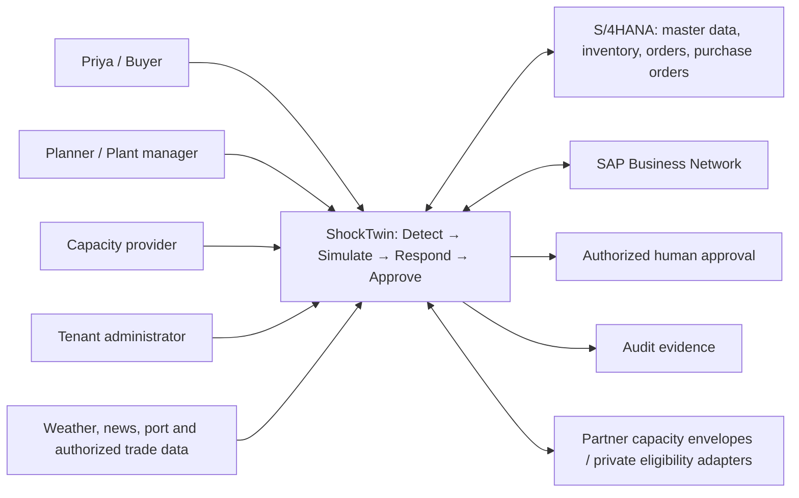
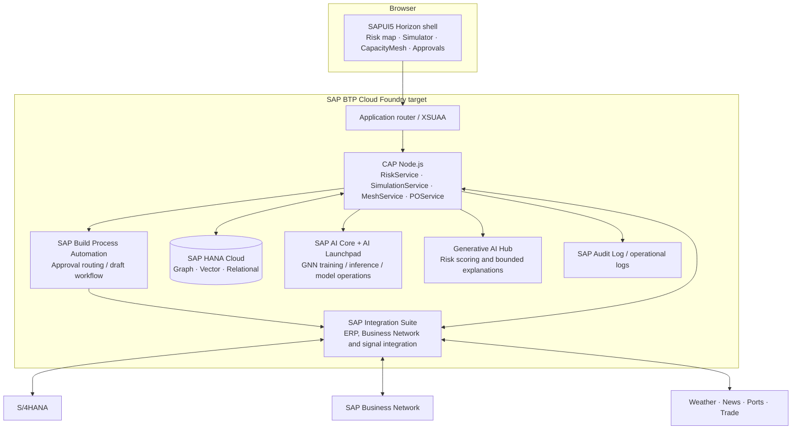
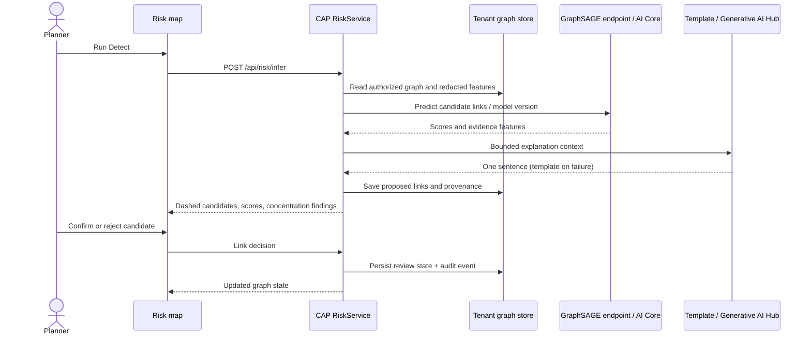
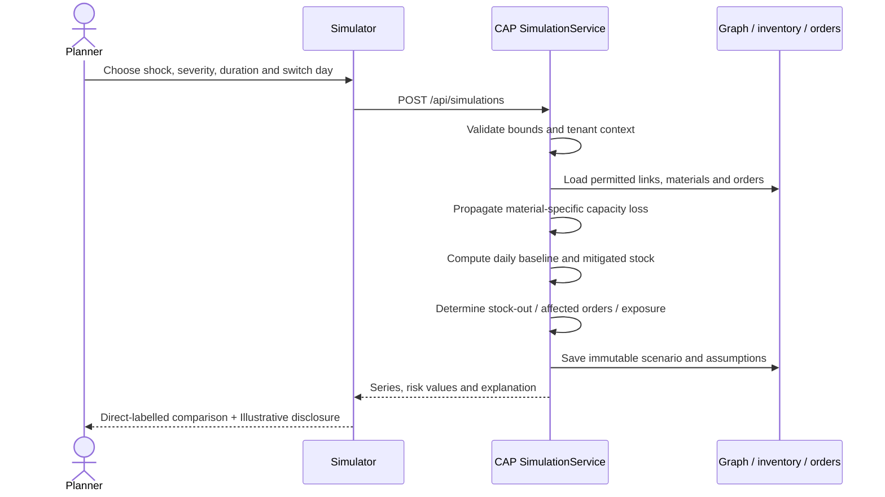
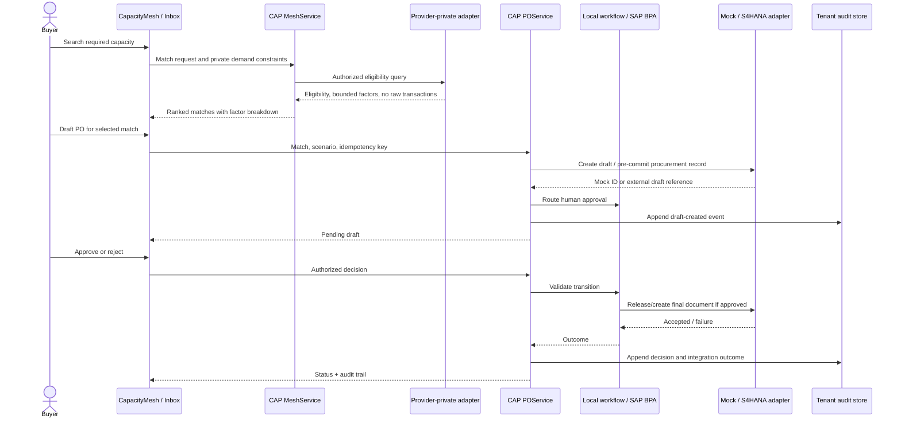

# ShockTwin — SAP BTP Architecture

| Field              | Value                                                                                                  |
| ------------------ | ------------------------------------------------------------------------------------------------------ |
| Version / date     | 0.1 / 23 October 2026                                                                                  |
| Owners             | Francis Reuben R, Avaneesh, Affan, Vivek                                                               |
| Governing contract | [PRD](PRD.md)                                                                                          |
| Status             | Implementable local MVP and SAP production target; cloud provisioning/integration verification pending |

## 1. Architecture decisions and boundaries

ShockTwin uses a SAPUI5 Horizon application, SAP Cloud Application Programming Model (CAP) Node.js domain services, a supplier graph, a Python link-prediction endpoint and a human-controlled response workflow. CapacityMesh belongs to Respond within this application. It is not a separate product. The local profile uses SQLite, a S/4HANA mock, mock signals and a local workflow so no SAP account or LLM key is needed after dependencies are installed.

The production target uses SAP BTP Cloud Foundry, HANA Cloud, XSUAA, Integration Suite, Build Process Automation, AI Core/AI Launchpad and Generative AI Hub. Deployment descriptors do not demonstrate service provisioning, entitlement availability or a tested live SAP integration. Those remain [VERIFY]. All local business records and scenario outputs are **Illustrative**.

**Tooling correction:** SAP Build Apps is a distinct low-code runtime, not a SAPUI5 source generator. The shipped frontend is authored as freestyle SAPUI5 using locally served OpenUI5 assets and Horizon, with a Fiori launchpad-style sandbox. An optional Build Apps companion and Fiori elements administration can consume the same OData services [VERIFY]. Do not describe this code as generated by Build Apps.

A single deployable frontend shell contains risk-map, simulator, capacitymesh and approvals modules. Independent microfrontend deployments would add unnecessary release and routing overhead for this MVP; the module boundaries leave that option open later.

## 2. System context



The buyer tenant owns its transactions and graph. Provider tenants own private capacity constraints. The federation publishes minimal envelopes and answers private eligibility requests under provider authorization. The local demo emulates these boundaries; it does not operate a real inter-company federation.

## 3. Container diagram and responsibilities



| Container / module             | Responsibility                                                                                                     | Local implementation / production target                                                                  |
| ------------------------------ | ------------------------------------------------------------------------------------------------------------------ | --------------------------------------------------------------------------------------------------------- |
| UI shell and four view modules | Workflow navigation, graph review, scenario controls, ranked responses, approvals and evidence.                    | npm OpenUI5 assets served locally; SAPUI5/Horizon shell. Optional Build Apps consumer [VERIFY].           |
| RiskService                    | Tenant graph projection, concentration scoring, inference orchestration and link-review persistence.               | CAP service; Python HTTP endpoint locally, AI Core deployment target.                                     |
| SimulationService              | Validate assumptions, propagate loss, compute stock/coverage/order exposure, persist scenarios.                    | Deterministic CAP domain logic; HANA persistence in production.                                           |
| MeshService                    | Publish safe envelopes, evaluate private eligibility, score and explain matches.                                   | Seeded provider adapter locally; authenticated partner federation target.                                 |
| POService                      | Idempotent draft creation, state transitions, ERP adapter invocation and audit events.                             | Mock OData and local workflow; Integration Suite/BPA target.                                              |
| HANA Cloud                     | Supplier graph workspace, authorized news embeddings in vector engine, relational scenarios/listings/drafts/audit. | SQLite development entities; graph/vector-specific production queries require validation [VERIFY].        |
| AI Core / AI Launchpad         | Versioned synthetic training, saved model serving, deployment/model operations.                                    | Python GraphSAGE/FastAPI endpoint; model container/workflow packaging for target.                         |
| Generative AI Hub              | News-location risk summaries and plain-language explanations.                                                      | OpenAI-compatible optional local endpoint; deterministic templates when unconfigured.                     |
| Integration Suite              | Normalize source contracts, isolate credentials, implement retries and ERP mapping.                                | Local S/4HANA and signals mocks; live flows/endpoints [VERIFY].                                           |
| Build Process Automation       | Route draft to authorized approver, track outcome and retry downstream actions.                                    | Local state machine is executable; remote process definition must be imported/configured/tested [VERIFY]. |

## 4. Data model and seed contract

CDS entity keys are `String`, permitting stable demo identifiers. Storage may use CDS-style `ID`; REST serialization normalizes them to `id`. Every private entity carries `tenantId`. Source evidence must be redacted before display or LLM use. Timestamps are UTC ISO 8601. Money uses a currency field; local business values are Illustrative.

| Entity            | Key fields / relationships                                                                                                                                            | Privacy and semantics                                                                                                                                              |
| ----------------- | --------------------------------------------------------------------------------------------------------------------------------------------------------------------- | ------------------------------------------------------------------------------------------------------------------------------------------------------------------ |
| Company           | id, tenantId, name, location, latitude, longitude                                                                                                                     | `buyer` is Priya's Illustrative Bengaluru company.                                                                                                                 |
| Supplier          | id, tenantId, companyId, name, tier, location, materialId                                                                                                             | `s1`…`s5` are immediate suppliers; supplier roles and commercial data stay tenant private.                                                                         |
| Plant             | id, tenantId, companyId, name, location, latitude, longitude, capacity                                                                                                | `resin-plant` is the hidden shared upstream plant. Other upstream plants support known links.                                                                      |
| Material          | id, tenantId, name, unit, inventory, dailyDemand, unitValue, currency                                                                                                 | `resin`: inventory 1,800 units; daily demand 100 units. These quantities are Illustrative.                                                                         |
| Lane              | id, tenantId, sourceId, targetId, distanceKm, leadTimeDays                                                                                                            | Private logistics relation; distance used for local ranking is seeded or computed from coordinates and disclosed.                                                  |
| Link              | id, tenantId, sourceId, targetId, materialId, dependencyShare, inferred, confidence, evidence, reviewStatus, modelVersion                                             | Direction is upstream **source → downstream target**. `reviewStatus`: known, proposed, confirmed or rejected. Confidence is an uncalibrated synthetic-model score. |
| Shock             | id, tenantId, type, nodeId, location, severity, durationDays, source, observedAt                                                                                      | Types: cyclone, portClosure, strike, fire. Mock signal `cyclone-1` near resin plant.                                                                               |
| Scenario          | id, tenantId, shockId/type, input, baselineSeries, mitigatedSeries, daysToStockout, ordersAtRisk, revenueAtRisk, createdAt                                            | Store assumptions and results; immutable result snapshot, not live forecast.                                                                                       |
| CapacityListing   | id, providerTenantId, capacityType, location, startDate, endDate, priceBand; private volume, leadTime, capabilities                                                   | Public projection contains only type, location, dates and price band, plus a non-semantic opaque id needed for selection.                                          |
| Match             | id, tenantId, scenarioId, listingId, request, score, breakdown, eligible, explanation, createdAt                                                                      | Private computed decision result. Does not expose provider raw transactions.                                                                                       |
| DraftPO           | id, tenantId, matchId, scenarioId, idempotencyKey, supplierRef, quantity, currency, priceBand, status, requestedDecision, externalId, createdBy, createdAt, decidedAt | Status: pending, transient processing, approved, rejected or integrationError; local record explicitly identifies mock mode.                                       |
| AuditEvent        | id, tenantId, actor, action, entityType, entityId, before, after, timestamp, correlationId                                                                            | Append-only application API; production durable audit retention/tamper controls [VERIFY].                                                                          |
| Order / Inventory | id, tenantId, materialId, quantity, dueDay, value/currency; materialId, onHand, dailyBurn                                                                             | Operational inputs for order exposure; local records are Illustrative.                                                                                             |

### Stable local fixture

- Company `buyer`; five tier-1 suppliers `s1`…`s5`; hidden plant `resin-plant`; three other upstream plants `known-plant-1`…`known-plant-3`.
- Five known tier-1 links feed `buyer`. Three known tier-2 links feed `s3`, `s4`, `s5` for other inputs. Hidden links `hidden-1`…`hidden-3` connect `resin-plant` to `s1`, `s2`, `s3` and start unconfirmed.
- The three resin-carrying supplier-to-buyer relationships each cover one-third of the critical resin requirement. Their resin loss contributions sum to one; other supplier/material edges must not dilute critical resin demand.
- `resin` inventory 1,800 and burn 100 units/day yield 18 days' initial coverage. Default shock is total capacity loss, duration 28 days, horizon 30 days. At end of day 18, baseline stock is zero.
- Mitigation starts after day 3 consumption. Replacement flow of 100 units/day holds remaining stock at 1,500 from day 3 through the horizon. This requires sufficient provider volume/duration and is an Illustrative conditional outcome.
- Six capacity listings within 300 km; three eligible moulding listings within 150 km; dates cover the scenario. Local prices, distance, volume, lead time and order values are Illustrative. Do not quote them as market observations.

## 5. Hidden-link inference sequence



### GNN method

Use a PyTorch Geometric GraphSAGE encoder with dot-product or MLP link decoder and negative sampling. Node features include normalized geography, material/capability indicators, role/tier, synthetic product-family structure and observed graph-neighborhood summaries. Permitted future evidence includes authorized PO/invoice/material co-occurrence, trade routes and shared locations; the local model does not consume real trade records.

Generate a synthetic graph with clustered product families and upstream/downstream dependencies. Fix random seeds and save dataset/split metadata, feature transformations, model weights and actual held-out metrics. Hold out positive edges before constructing the message-passing training graph; sample negatives separately, document their distribution and avoid leaking held-out target labels through features. Synthetic graph homophily and shared families remain a material generalization limitation.

Return each candidate's model score and top observable evidence features. Feature-based explanations describe association; they are not a causal attribution or proof that the model used a feature in a particular way. Confidence thresholds are configurable design parameters: proposed default display threshold 0.60, high-priority review threshold 0.80, and never automatic confirmation. Threshold suitability on real data is [VERIFY]. Persist actual scores; never replace a disappointing model result with a hardcoded confidence.

Kosasih & Brintrup, International Journal of Production Research (2022), provides the research basis for automotive supplier-link prediction. No AUC or accuracy from that paper is asserted. This repository must publish only its own measured **Synthetic-data results**, including split caveats.

## 6. Shock simulation sequence and mathematics



For a shocked node, normalized capacity loss is severity `s ∈ [0,1]` for the specified duration. Along an edge, loss contribution is upstream loss × material-specific dependency share. Aggregate independent contributions at a node, capped at one. Evaluate a topological order where possible; cycles require an explicitly bounded fixed-point calculation or rejection with a clear error, never an infinite traversal. Missing dependency shares are disclosed assumptions, not invented evidence.

For material `m` on day `t`: `stock[t] = max(0, stock[t−1] + normalInbound[t] + replacementInbound[t] − dailyDemand[t])`. Lost upstream capacity reduces normal inbound. The default total-loss scenario has no normal resin inbound during the shock; after recovery, inbound resumes at the daily requirement. A partial loss reduces net burn accordingly. Material, dependency, inventory and timing assumptions remain visible in the response.

**Time-to-survive** is the first stock exhaustion time under the scenario; if not exhausted, return `null` and “beyond horizon,” not infinity or a fabricated day. **Time-to-recover** is the assumed restoration day from shock duration plus any explicit restart lead time; it is not inferred from stock-out. Compute baseline and mitigation independently. Day-3 replacement starts after day-3 burn, so the plotted remaining stock is 1,500 thereafter when replacement equals demand.

An order is at risk if its due-date material requirement cannot be met under the scenario's allocation rule. Revenue at risk is the sum of those seeded order values, with the stated currency and without double counting. It is exposure, not realized revenue loss. The MVP simplifies BOMs, substitutions, nonlinear production restart, shared inventory allocation and stochastic lead times; these limitations must appear in the UI/details or demo notes.

## 7. CapacityMesh matching and approved-PO sequence



Public listings publish only capacity type, location, availability dates and price band, with an opaque listing reference. Private volume, exact price, capability details, lead time, transaction history and buyer requirements stay with their owning tenant. The local adapter holds private seeded constraints and returns a buyer-specific match result; the production federation requires authenticated provider endpoints, consent and contracts [VERIFY].

First gate by capacity type, availability overlap, volume and requested radius. Rank eligible matches with a transparent weighted score: capability fit 30%, distance 25%, available-volume fit 20%, lead-time fit 15%, price-band fit 10%. These are **design weights**, not empirically validated economics. Normalize each factor to `[0,1]`, preserve the raw inputs privately, and return factor score, weight and weighted contribution. Distance score decreases to zero at the radius; volume is capped at full requested coverage; lead time must fit the scenario; price bands use an explicitly documented ordering. Break ties deterministically by listing id. No match is a valid result.

The decision handler atomically claims a pending draft as `processing`. A clearly failed downstream delivery persists `integrationError` and the original requested decision; a controlled retry must retain that decision. An ambiguous commitment is marked `ERP_AMBIGUOUS_COMMIT`, disables retries/opposite decisions, and requires operator reconciliation. The local failure tests exercise these guards. Production external-reference reconciliation and its S/4HANA query semantics remain [VERIFY].

PO drafting must not imply that a real SAP purchase was committed. In production, the exact draft/release semantics of `API_PURCHASEORDER_PROCESS_SRV` depend on the S/4HANA edition and available business workflow [VERIFY]. The adapter separates local pending approval from downstream commitment and reconciles ambiguous failures; never assume a remote draft facility without testing it.

## 8. API contract

### Transport, identity and errors

REST under `/api` is a thin adapter in `server.js` that dispatches to the four CAP domain services. Equivalent OData service entities/actions are available under `/odata/v4/risk`, `/odata/v4/simulation`, `/odata/v4/mesh` and `/odata/v4/po`; exact generated metadata is authoritative. Shared domain functions ensure REST and OData produce the same business behavior.

Local default identity is explicitly a development Buyer/Planner in the Illustrative tenant. Production obtains tenant/user/roles from validated XSUAA JWT context; arbitrary request headers cannot select another tenant. JSON request numbers are validated and bounded. Errors use `{ "error": { "code": "VALIDATION_ERROR", "message": "Severity must be between 0 and 1", "correlationId": "..." } }` and suitable HTTP 400/401/403/404/409/502 codes. Cross-tenant identifiers return no private record. Money is accompanied by currency; all examples below are **Illustrative**.

### Endpoint inventory

| REST                                | CAP service action/entity              | Purpose                                                                               |
| ----------------------------------- | -------------------------------------- | ------------------------------------------------------------------------------------- |
| GET `/api/state`                    | RiskService aggregate state            | Seeded tenant workspace, graph and current workflow state.                            |
| POST `/api/risk/infer`              | RiskService `infer`                    | Actual ML request, persist proposed links and concentration findings.                 |
| POST `/api/risk/links/:id/decision` | RiskService `decideLink`               | Confirm/reject a proposed edge.                                                       |
| POST `/api/simulations`             | SimulationService `simulate`           | Validate and persist baseline/mitigation scenario.                                    |
| GET `/api/mesh/listings`            | MeshService public Listings projection | Minimal public envelope only.                                                         |
| POST `/api/mesh/listings`           | MeshService `publishListing`           | CapacityProvider publishes its own validated listing; owner/tenant derived from auth. |
| POST `/api/mesh/matches`            | MeshService `findMatches`              | Private eligibility and transparent ranking.                                          |
| POST `/api/pos`                     | POService `createDraft`                | Idempotent adapter-backed draft creation.                                             |
| GET `/api/pos`                      | POService DraftPOs projection          | Authorized tenant inbox.                                                              |
| POST `/api/pos/:id/decision`        | POService `decide`                     | Human approval/rejection with role enforcement.                                       |
| GET `/api/audit`                    | POService AuditEvents projection       | Tenant audit timeline.                                                                |
| GET `/health`                       | Runtime health handler                 | CAP, DB and dependency health without secrets.                                        |

### State and inference examples

`GET /api/state` returns a normalized UI projection:

```json
{
  "meta": { "illustrative": true, "mode": "local", "tenantId": "demo" },
  "company": { "id": "buyer", "name": "Priya Auto Components" },
  "nodes": [
    { "id": "buyer", "type": "company", "name": "Priya Auto Components" },
    { "id": "s1", "type": "supplier", "tier": 1, "name": "Supplier One" }
  ],
  "links": [
    {
      "id": "tier1-1",
      "source": "s1",
      "target": "buyer",
      "materialId": "resin",
      "dependencyShare": 0.333333,
      "inferred": false,
      "reviewStatus": "known"
    }
  ],
  "signals": [
    { "id": "cyclone-1", "type": "cyclone", "nodeId": "resin-plant", "illustrative": true }
  ],
  "inventory": [{ "materialId": "resin", "onHand": 1800, "dailyBurn": 100, "unit": "units" }],
  "orders": [],
  "scenarios": [],
  "draftPOs": [],
  "audit": []
}
```

The example is truncated to demonstrate field names; the actual seed returns all five suppliers and complete authorized records. Public listings are fetched separately so private match constraints cannot leak through the state aggregate.

`POST /api/risk/infer` accepts `{}`. Response shape:

```json
{
  "illustrative": true,
  "nodes": [{ "id": "resin-plant", "type": "plant", "name": "Shared Resin Plant" }],
  "links": [
    {
      "id": "hidden-1",
      "source": "resin-plant",
      "target": "s1",
      "materialId": "resin",
      "inferred": true,
      "reviewStatus": "proposed",
      "confidence": 0.0,
      "evidence": ["Shared material family", "Compatible geography"],
      "explanation": "A candidate shared resin relationship is suggested by material and location features."
    }
  ],
  "singlePointsOfFailure": [
    { "nodeId": "resin-plant", "affectedTier1": 3, "totalTier1": 5, "risk": "high" }
  ],
  "model": {
    "version": "synthetic-graphsage-v1",
    "trainingDomain": "synthetic",
    "metricsSource": "ml/model/metrics.json"
  }
}
```

Here `0.0` is a schema example only, **not a claimed prediction**: the running service inserts the actual computed confidence. Single-point-of-failure scoring is affected resin-dependent tier-1 suppliers / resin-dependent tier-1 suppliers, alongside the descriptive count three of five total suppliers; do not confuse those denominators. `POST /api/risk/links/hidden-1/decision` accepts `{"decision":"confirmed"}` or `{"decision":"rejected"}` and returns the updated link plus audit event id.

### Simulation example

```json
{ "shockType": "cyclone", "duration": 28, "severity": 1, "switchDay": 3, "includeInferred": true }
```

`POST /api/simulations` accepts the above with default node `resin-plant`, material `resin`, horizon 30 and replacement 100 units/day. Optional `replacementVolume` supports sensitivity analysis. Response:

```json
{
  "id": "scenario-1",
  "illustrative": true,
  "assumptions": {
    "shockType": "cyclone",
    "duration": 28,
    "severity": 1,
    "switchDay": 3,
    "horizon": 30,
    "dailyDemand": 100,
    "replacementVolume": 100,
    "includeInferred": true
  },
  "daysToStockout": 18,
  "mitigatedDaysToStockout": null,
  "timeToRecover": 28,
  "baselineSeries": [
    { "day": 0, "stock": 1800 },
    { "day": 18, "stock": 0 }
  ],
  "mitigatedSeries": [
    { "day": 0, "stock": 1800 },
    { "day": 3, "stock": 1500 },
    { "day": 30, "stock": 1500 }
  ],
  "ordersAtRisk": [],
  "revenueAtRisk": 0,
  "currency": "INR",
  "warnings": ["Illustrative; unconfirmed inferred links included when present"]
}
```

Series examples omit intermediate daily points; the service returns every day. Orders and revenue examples are empty/zero shape examples; actual values are computed from seed orders. Excluded/rejected links and absent critical paths must change exposure honestly. `includeInferred` adds proposed/confirmed hypotheses but never rejected edges; confirmed edges remain included regardless of the proposed-edge toggle.

### Matching example

`GET /api/mesh/listings` returns `{"illustrative":true,"listings":[{"id":"capacity-1","capacityType":"moulding","location":{"name":"Bengaluru region","latitude":12.97,"longitude":77.59},"startDate":"2026-10-23","endDate":"2026-11-30","priceBand":"medium"}]}`. Coordinates are Illustrative; never return private volume or transaction data in this endpoint.

`POST /api/mesh/listings` accepts `{"capacityType":"moulding","location":{"name":"Bengaluru region","latitude":12.97,"longitude":77.59},"startDate":"2026-10-23","endDate":"2026-11-30","priceBand":"medium"}`. Only CapacityProvider may publish; tenant/owner come from trusted context. The response is the same safe public envelope plus its opaque id. Private capability/volume constraints are managed by the provider adapter, never arbitrary public-record fields. Unknown fields, invalid dates and attempted owner overrides are rejected.

`POST /api/mesh/matches` request:

```json
{
  "capacityType": "moulding",
  "radiusKm": 150,
  "volume": 100,
  "startDate": "2026-10-26",
  "endDate": "2026-11-22",
  "scenarioId": "scenario-1"
}
```

Response shape:

```json
{
  "illustrative": true,
  "matches": [
    {
      "id": "match-1",
      "listingId": "capacity-1",
      "capacityType": "moulding",
      "location": "Bengaluru region",
      "distanceKm": 80,
      "score": 0.0,
      "eligible": true,
      "breakdown": {
        "capability": { "score": 1, "weight": 0.3 },
        "distance": { "score": 0.466667, "weight": 0.25 },
        "volume": { "score": 1, "weight": 0.2 },
        "leadTime": { "score": 1, "weight": 0.15 },
        "priceBand": { "score": 0.5, "weight": 0.1 }
      },
      "explanation": "This eligible moulding option ranks first on the displayed capability, distance, volume, lead-time and price-band factors."
    }
  ],
  "totalEligible": 1
}
```

Scores above are response-shape examples, not promised ranking results. The service computes the weighted sum and returns actual factors; listing distances and candidate counts come from seed data. Internal provider facts may be returned as bounded factor scores to the requesting buyer, not raw provider transactions or general public fields.

### Draft and decision examples

`POST /api/pos` accepts `{"matchId":"match-1","scenarioId":"scenario-1","idempotencyKey":"priya-demo-response-1"}`. Response: `{"id":"po-1","status":"pending","mode":"mock","matchId":"match-1","scenarioId":"scenario-1","externalId":"MOCK-PO-1","illustrative":true}`. Same tenant/key returns the same draft. Unknown/ineligible match or cross-tenant scenario is rejected.

`POST /api/pos/po-1/decision` accepts `{"decision":"approved"}` or `{"decision":"rejected","reason":"Qualification pending"}`. Response contains the updated draft and audit event. `GET /api/pos` returns `{"draftPOs":[...]}`. `GET /api/audit` returns `{"events":[{"id":"audit-1","actor":"Priya","action":"PO_APPROVED","entityId":"po-1","before":"pending","after":"approved","timestamp":"2026-10-23T10:00:00Z","correlationId":"request-1"}]}`. All example identifiers and timestamps are Illustrative.

## 9. Security, privacy and compliance

XSUAA role collections map Buyer to draft/decision actions, Planner to graph review/simulation/matching, CapacityProvider to its own listings and Admin to tenant configuration. Enforce checks in CAP business handlers as well as routing; hiding UI controls is insufficient. Admin does not silently bypass a separate purchasing authority policy. Local mock users are a development convenience only and must be disabled in the production profile.

For the local federation, a small SQLite provider keeps all Illustrative tenants in one file while every private business query applies explicit `tenantId` predicates; this avoids CAP’s default per-tenant filename suffix producing unseeded demo databases. Integration tests use an isolated temporary SQLite file and exercise foreign-tenant access. Production HANA tenant provisioning/isolation must be validated independently [VERIFY].

Tenant identifiers come from validated authentication context. Apply tenant predicates to reads, updates, idempotency keys, scenario/match foreign references and audit queries. Never trust a browser-supplied tenant id in production. Public listing projections use an allowlist. No raw invoices, purchase orders, inventory, personal contact details or competitor demand are sent through CapacityMesh or LLM prompts.

Use destination/service bindings for production secrets, TLS, bounded payloads, parameterized persistence, structured validation, no secret logs, and dependency scanning. Return correlation IDs and sanitized errors. Keep append-only application audit events for link decisions, draft creation and status transitions; send production audit evidence to SAP Audit Log with retention controls [VERIFY].

DPDP Act 2023 considerations include identifying personal-data fields, lawful processing and notice/consent requirements, minimization, purpose/retention controls, access/deletion processes, processor arrangements, incident response and cross-border restrictions as applicable. This is an engineering checklist, not legal certification; counsel must verify applicability. Commercial data sharing and antitrust review are separately required before inter-competitor federation.

## 10. Error handling and observability

Each request carries/generates a correlation ID. Log domain action, duration, tenant-safe record identifiers and error code without raw payloads or secrets. Health reports distinguish CAP/database, ML, mocks and optional LLM dependencies. LLM failure falls back to template explanation; inference failure reports a retryable error and preserves the graph; integration failure preserves an explicit error/pending state rather than announcing success.

Track inference latency, candidate/review counts, simulation latency, eligible-match counts, idempotency reuse, workflow decisions and downstream errors. Business metric definitions are in the PRD; no collected demo metric is represented as customer impact. Production metrics, alerts, log retention and operator ownership remain [VERIFY].

## 11. Repository, deployment and CI/CD

The repository root is the `shocktwin/` monorepo represented by this checkout: `app/`, `srv/`, `db/`, `ml/`, `integrations/`, `workflow/`, `tests/`, `docs/`, `scripts/`, root deployment/configuration files and `.github/workflows/ci.yml`. Avoid a redundant nested repository directory.

Development uses Node 20.19+-compatible CAP 8, SQLite, Python 3.11+ and local npm OpenUI5. `npm install`, `npm run seed`, `npm run dev` is the documented path. Seed resets only the local Illustrative database/model fixture. The development launcher starts CAP, S/4HANA mock, signals mock and ML endpoint, prints the launchpad URL and attempts to open it where a desktop browser is available. In headless environments it provides the URL.

The local minimum is Node 20.19+; the production application router runs on Node 22/24, with Node 24 selected for the complete target. Production uses CAP `[production]` profile with HANA and XSUAA; a development profile selects SQLite and mock authentication. `mta.yaml` describes CAP srv, HANA deployer, app router, XSUAA and HANA resources, with destinations/remote dependencies explicit. `xs-security.json` defines scopes/templates for Buyer, Planner, CapacityProvider and Admin. `mbt build && cf deploy mta_archives/<archive>.mtar` is the target packaging/deployment path after a BTP subaccount, Cloud Foundry space, entitlements, service plans and destinations are configured [VERIFY]. AI Core model deployment and BPA process activation are separately managed artifacts, not magically provisioned by the CAP MTA.

GitHub Actions runs lockfile installation, lint, service/unit tests, model smoke test and end-to-end demo. A deployment job, when configured, must obtain protected environment credentials and verify a staging flow before promotion. Do not store service keys in source control. The repository run report records actual local checks; no live cloud deployment is claimed without evidence.

## 12. Scalability and cost

10,000 supplier nodes is a production **target**, not a demonstrated capacity. Paginate graph neighborhoods and listing results, index tenant/id/material/status, avoid per-edge database calls, batch inference and cache immutable model artifacts. Use asynchronous training/inference jobs for large networks, neighborhood sampling for GraphSAGE, and material-specific graph traversal. Benchmark edge density, degree skew, scenario count and concurrency as well as node count.

The UI should render a bounded neighborhood and cluster large networks rather than send all nodes to a force graph. HANA graph workspace/vector-index setup and query plans require production validation. Separate long model jobs from interactive CAP requests and cap scenario horizon/payload size.

No SAP price or cost estimate is invented. Relevant cost drivers are HANA memory/storage, Cloud Foundry app instances, AI Core training/inference, integration messages, BPA process usage, LLM tokens, observability and outbound data. Trial quotas, region availability and free allocations are [VERIFY]. Use deterministic explanations, bounded LLM context and scheduled/batched inference to control usage; set budgets after service-plan verification.

## 13. MVP versus production and known limitations

| Capability           | Hackathon MVP                                                 | Production target / limitation                                                                       |
| -------------------- | ------------------------------------------------------------- | ---------------------------------------------------------------------------------------------------- |
| ERP / signals        | Local mock OData and Illustrative signals                     | Integration Suite + authorized real S/4HANA/Business Network/weather/news/trade APIs [VERIFY].       |
| Graph / data         | CAP entities on SQLite; in-process material traversal         | HANA graph/vector/relational deployment and workload tuning [VERIFY].                                |
| AI links             | Real GraphSAGE trained/evaluated on synthetic graph           | AI Core serving and real-network validation; synthetic scores are not calibrated real probabilities. |
| LLM                  | Optional endpoint or deterministic fallback                   | Generative AI Hub binding and approved model/retention policy [VERIFY].                              |
| Workflow             | Executable local state machine and mock ERP                   | BPA routing, real purchasing semantics and downstream reconciliation [VERIFY].                       |
| Capacity federation  | Minimal public projection plus local private provider adapter | Multi-tenant provider consent, live freshness, qualification and bilateral contracts [VERIFY].       |
| Auth / tenancy       | Development identity plus tenant-scoped service behavior      | XSUAA validation/bindings and real multi-tenant penetration tests [VERIFY].                          |
| UX / app build       | Freestyle SAPUI5 Horizon; local launchpad-style sandbox       | Optional Fiori elements/Build Apps consumer; formal accessibility review [VERIFY].                   |
| Availability / scale | Documented local health and offline demo                      | Proposed PRD service levels and 10,000-node benchmark remain unverified.                             |

The MVP is deterministic and intentionally small. It cannot establish real hidden commercial relationships, fully represent BOM/substitution constraints, guarantee alternate supplier qualification or promise continuity beyond the simulated horizon. Model evaluation, source statistics and demo outcomes must remain distinct in every document and slide. External quantitative claims are limited to the PRD evidence register; SAP plan/API availability and legal conclusions remain [VERIFY].
