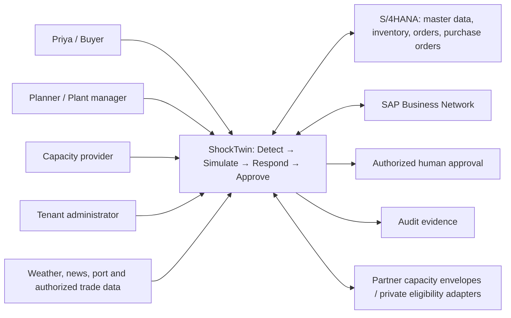
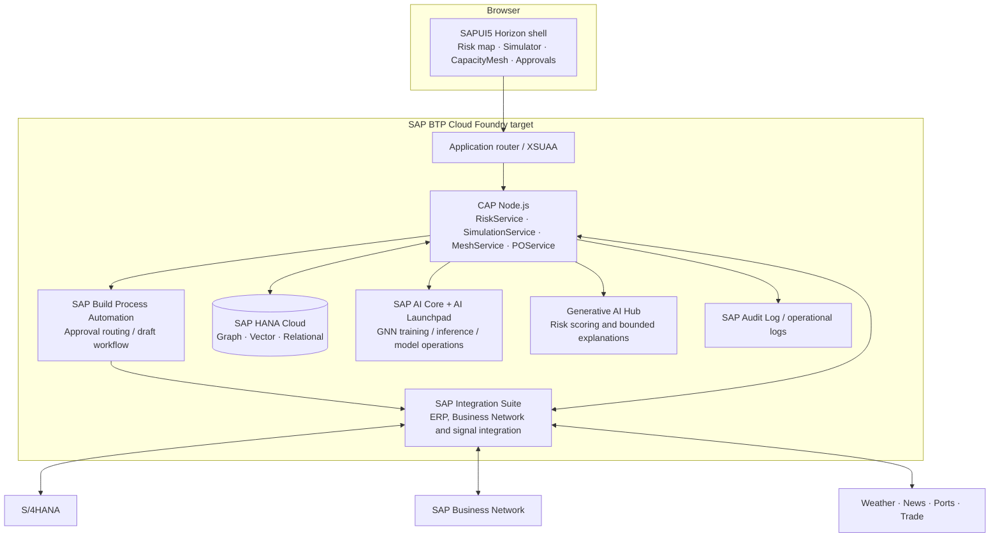
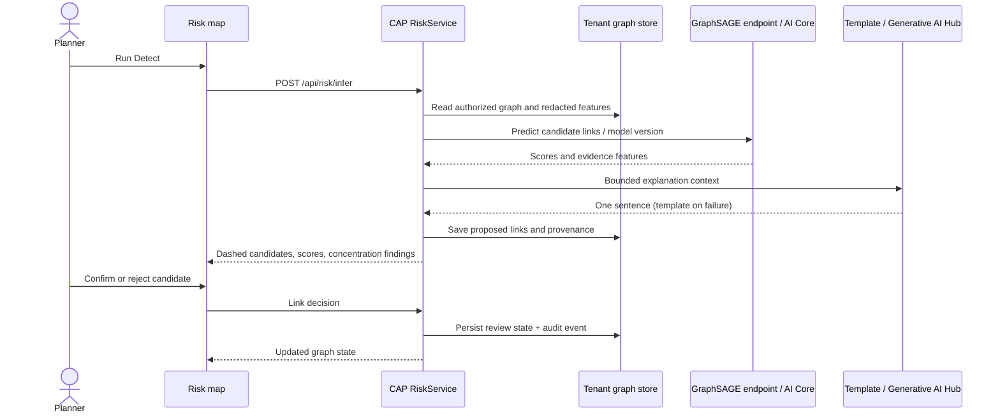
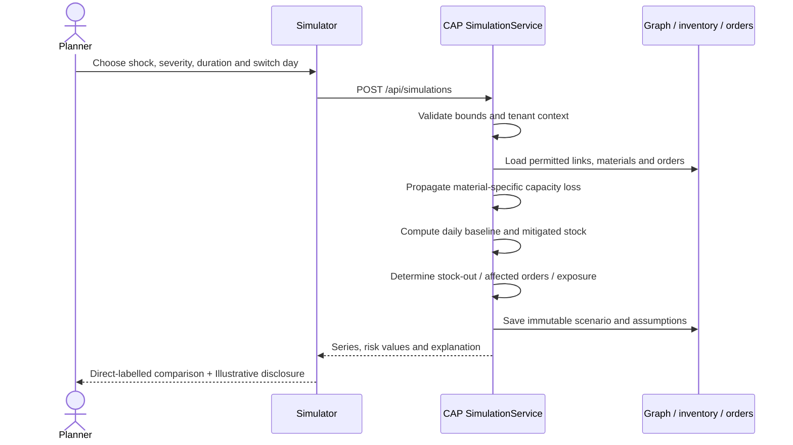
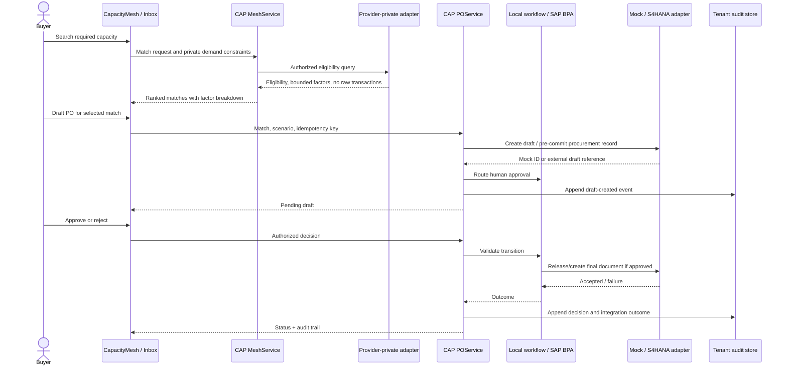
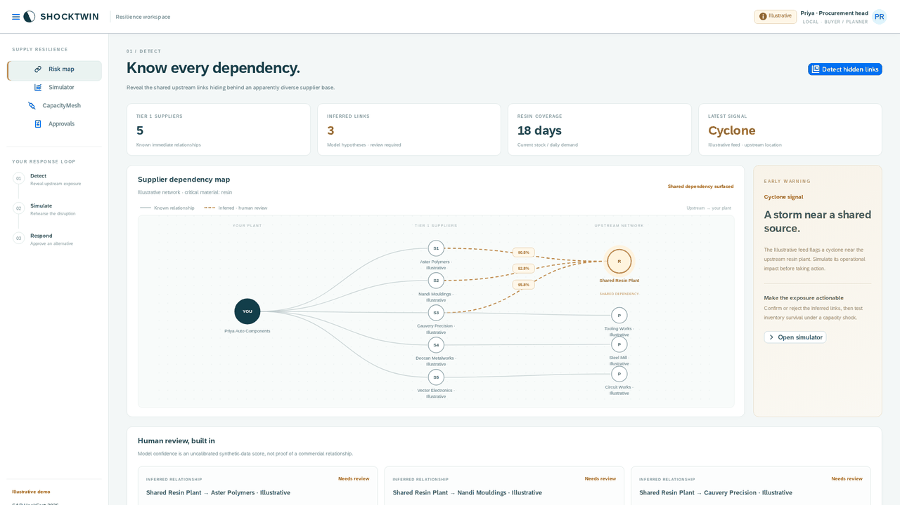
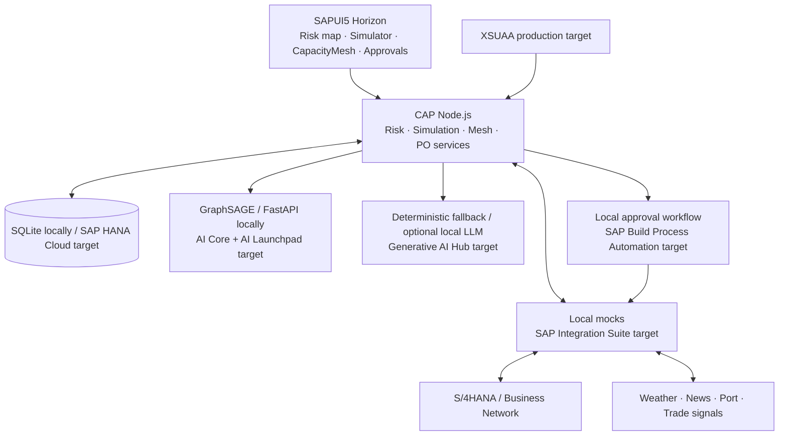

# ShockTwin — Product Requirements Document

| Field   | Value                                                                                 |
| ------- | ------------------------------------------------------------------------------------- |
| Product | ShockTwin, with CapacityMesh as its response capability                               |
| Version | 0.1                                                                                   |
| Owners  | Francis Reuben R, Avaneesh, Affan, Vivek — B.Tech CSE, RV University                  |
| Date    | 23 October 2026                                                                       |
| Status  | Hackathon MVP contract; production integrations and service levels require validation |
| Event   | SAP HackFest 2026, RV University college round, Bengaluru                             |
| Track   | Resilient Supply Chains                                                               |
| Pitch   | **See the supply shock coming. Borrow the capacity to survive it.**                   |

## 1. Problem statement

Procurement teams can know their immediate suppliers while remaining unaware that apparently independent suppliers depend on the same upstream plant. When that plant fails, a buyer must establish the true exposure, work out when inventory will run out, find qualified alternatives, and authorize a response across disconnected systems. Visibility that does not lead to an executable response leaves the production line exposed.

ShockTwin connects **Detect → Simulate → Respond → Approve** in one decision workflow. Detect proposes hidden supplier links with confidence and evidence. Simulate translates a specific disruption into inventory, order and revenue consequences. Respond uses CapacityMesh to rank published spare capacity. Approve produces an auditable human decision on a draft purchase order. CapacityMesh is a response step within ShockTwin, not a separate product or pitch.

This MVP demonstrates the workflow using **Illustrative** company, supplier, inventory, signal, capacity, order and price data. It does not establish real supplier relationships, predict a real cyclone, guarantee production continuity or demonstrate realized financial savings.

## 2. Why now

| Evidence from the supplied fact bank                                                                                                                                         | Product implication                                                                                                                                     | Source     |
| ---------------------------------------------------------------------------------------------------------------------------------------------------------------------------- | ------------------------------------------------------------------------------------------------------------------------------------------------------- | ---------- |
| Visibility beyond tier 1 fell from 56% in 2022 to 37% in 2023 to 30% in 2024; only 33% invest in early-warning systems; response to a new disruption averages about 2 weeks. | Make upstream exposure and time remaining visible in the same workspace.                                                                                | [F2]       |
| About 10% of firms see tier-3 suppliers; about two-thirds of disruptions originate at tier 2 or deeper.                                                                      | Surface upstream hypotheses rather than assume tier-1 diversity equals resilience.                                                                      | [F3], [F4] |
| Renesas supplied about 30% of automotive microcontrollers in March 2021. Separately, the overall 2021 chip shortage cost automakers $210B in revenue and 7.7M vehicles.      | Connect a concentrated dependency to a business decision, without attributing the entire chip-shortage loss to one fire.                                | [F1]       |
| Disruptions lasting a month or more occur about every 3.7 years; over a decade they cost about 45% of one year's profits.                                                    | Rehearsal and response deserve a repeatable workflow. These are published context, not ShockTwin impact estimates.                                      | [F5]       |
| India truck empty running is up to 40%; manufacturing capacity utilisation is 74.6%.                                                                                         | Investigate whether available assets can become a qualified response, with no assumption that every unused asset is suitable or commercially available. | [F9]       |
| GNN link prediction has been studied on a real automotive supply network.                                                                                                    | Use the research as a method basis; evaluate this implementation independently on synthetic data.                                                       | [F8]       |

The 74.6% utilisation figure is supplied as RBI OBICUS Q1 2026–27; publication availability and exact series must be checked before external use [VERIFY]. Statistical context is not a product-performance claim.

## 3. Target users and personas

| Persona                                           | Situation and decision                                                                                                           | Needed outcome                                                                                                         | Access                                       |
| ------------------------------------------------- | -------------------------------------------------------------------------------------------------------------------------------- | ---------------------------------------------------------------------------------------------------------------------- | -------------------------------------------- |
| **Priya, procurement head**                       | Illustrative persona at a mid-size Bengaluru auto-parts manufacturer; knows five immediate suppliers and owns response approval. | Understand shared upstream dependency, compare mitigation options, approve or reject a draft with evidence.            | Buyer                                        |
| **Supply-chain planner**                          | Maintains material coverage and rehearses disruptions.                                                                           | Inspect inferred links, adjust scenario severity/duration, understand time-to-stock-out and affected orders.           | Planner                                      |
| **Logistics manager at a capacity-provider firm** | Publishes available transport, warehouse or manufacturing capacity while protecting commercial data.                             | Share a minimal listing, understand its availability and receive qualified interest without exposing raw transactions. | CapacityProvider                             |
| **Plant manager**                                 | Needs reliable material flow and must assess whether alternate production is operationally suitable.                             | Review capacity fit and production-continuity assumptions before procurement commits.                                  | Planner; Buyer only if separately authorized |
| **Tenant administrator**                          | Manages access and operational controls.                                                                                         | Assign roles, inspect audit events and manage tenant configuration.                                                    | Admin                                        |

These personas are design hypotheses. No customer interviews or pilot commitments are claimed.

## 4. Jobs to be done

1. When a new signal threatens a supplier location, help me identify the materials and orders that share the exposure so I can prioritize a response.
2. When a graph proposes an unknown upstream relationship, show its confidence and evidence so I can confirm or reject it instead of treating AI output as fact.
3. When I change a shock's duration, severity or mitigation timing, show the resulting stock trajectory so I can compare alternatives on explicit assumptions.
4. When my own network cannot absorb a shock, find capacity that meets capability, distance, timing and volume constraints so I can evaluate a practical alternative.
5. When an alternative looks viable, draft the procurement action and route it to an authorized human so I can act without losing accountability.
6. When I offer spare capacity, disclose only the information needed for matching so my raw transactions and unrelated commercial relationships remain private.

## 5. Goals and non-goals

### Goals

- Deliver a coherent, replayable five-step local demo with no SAP account or LLM key required.
- Reveal an **Illustrative** hidden resin plant shared by three of Priya's five tier-1 suppliers, using actual synthetic-trained GNN inference and an explicit review state.
- Explain a simulated line stop on day 18 without mitigation and demonstrate continuity through the displayed horizon when full replacement flow begins on day 3 (**Illustrative**).
- Rank capacity candidates transparently, create a draft through an adapter, and record approval or rejection with an audit trail.
- Preserve a clear boundary between measured local behavior, synthetic model evaluation, proposed SAP production capabilities and [VERIFY] deployment prerequisites.
- Keep code, setup instructions, demo script, architecture and presentation behavior consistent.

### Non-goals for v0.1

- Autonomous purchase commitment, automatic supplier qualification, automatic payment, or approval without an authorized human.
- Claiming inferred links are verified commercial relationships or that synthetic model metrics transfer to real networks.
- Live, comprehensive global customs ingestion, real-time weather forecasting, production multi-enterprise federation or a licensed financial-risk model.
- Demonstrating real customer savings, model accuracy without measured evaluation, legal compliance certification or a production uptime guarantee.
- Replacing ERP, APS, transport-management systems or SAP Business Network.
- Sharing raw purchase orders, invoices, supplier-specific demand, internal inventory or competitor strategy through CapacityMesh.

## 6. User stories and acceptance criteria

### Detect

**D1 — Review the known network.** As Priya, I want my immediate suppliers and known dependencies visible before I run detection.

- **Given** the seeded tenant, **when** I open the risk map, **then** I see my company, five tier-1 suppliers, three known tier-2 relationships, a visible “Illustrative” disclosure, and a distinction between known and inferred relationships.
- **Given** no inference has run, **when** I inspect the graph, **then** hidden candidate edges are not represented as confirmed links.

**D2 — Surface and review hidden relationships.** As a planner, I want a model-supported hypothesis that I can inspect.

- **Given** the local ML endpoint is healthy and the synthetic-trained weights exist, **when** I run Detect, **then** candidate relationships return a confidence score, model/version provenance, evidence features and a one-sentence explanation.
- **Given** a candidate crosses the configured display threshold, **when** the graph updates, **then** its edge is dashed amber and its confidence and unconfirmed state are visible.
- **Given** the demonstration fixture and trained model, **when** inference is run, **then** the three seeded hidden relationships are available for review; if a measured score fails the threshold, the UI reports the actual result rather than substituting a fabricated score.
- **Given** a proposed relationship, **when** I confirm or reject it, **then** its review state persists, an audit event records the action, and rejected links do not silently become confirmed simulation dependencies.
- **Given** inference fails, **when** Detect is requested, **then** the app shows a recoverable error and retains the last known graph; any optional cached inference is labelled as cached, never live inference.

### Simulate

**S1 — Quantify exposure.** As a planner, I want to simulate a disruption before inventory is exhausted.

- **Given** the resin material has 18 days of inventory at the seeded daily burn rate, **when** I run the default total-loss cyclone without mitigation for a horizon exceeding 18 days, **then** inventory reaches zero on day 18 and the UI labels the result “Illustrative.”
- **Given** a shock type of cyclone, port closure, strike or fire, **when** I adjust duration and severity within validated bounds and run, **then** the response contains the input assumptions, downstream capacity effects, material inventory series, days-to-stock-out, orders at risk and revenue at risk.
- **Given** an inferred relationship is included, **when** simulation runs, **then** the result discloses that unconfirmed links affect the scenario and allows the user to distinguish hypothesis-based exposure from confirmed exposure.
- **Given** full replacement flow equal to the affected daily requirement begins on day 3, **when** I compare mitigated and unmitigated curves, **then** mitigated stock remains at its day-3 level while replacement covers demand, and no line stop occurs within the displayed horizon. This is not an indefinite guarantee.
- **Given** lower volume, later switching or insufficient duration, **when** I rerun, **then** the curve follows the supplied assumptions rather than always showing success.
- **Given** invalid severity, duration or switch-day input, **when** I submit, **then** the service rejects the request with a useful validation error and no corrupt scenario is saved.

### Respond

**R1 — Find qualified spare capacity.** As Priya, I want a ranked response set with understandable tradeoffs.

- **Given** six seeded listings within 300 km, including three moulding candidates within 150 km, **when** I search for the required capacity, **then** eligible results are ranked by distance, capability fit, available volume, lead time and price band, and each result exposes its score breakdown.
- **Given** an incompatible capacity type or unavailable date range, **when** matching runs, **then** it is excluded or explicitly marked ineligible, never silently presented as a viable response.
- **Given** the federated public listing interface, **when** another tenant reads a listing, **then** only capacity type, location, available dates and price band are exposed. Detailed matching constraints are evaluated privately by the provider/local adapter; raw transactions remain private.
- **Given** no candidates satisfy the request, **when** matching finishes, **then** the UI shows an empty state with the active constraints and allows the planner to revise them.

**R2 — Draft a procurement action.** As Priya, I want a reviewable draft for the chosen candidate.

- **Given** an eligible match, **when** I choose “Draft PO,” **then** the service creates a draft through the S/4HANA adapter, records its source match and scenario, and puts it in the approvals inbox.
- **Given** a repeated request with the same idempotency key, **when** it is retried, **then** the same draft is returned rather than a duplicate commitment.
- **Given** a local run, **when** the draft is created, **then** the UI identifies the local mock and never implies a real ERP purchase was placed.

### Approve

**A1 — Keep commitment human controlled.** As a Buyer, I want the final decision to be explicit and auditable.

- **Given** a pending draft and Buyer authorization, **when** I approve, **then** its status changes once, an audit entry records actor, timestamp, draft identifier and old/new status, and the adapter/workflow result is visible.
- **Given** a pending draft, **when** I reject with a reason, **then** it becomes rejected, no purchase is committed, and the reason is retained in the audit history.
- **Given** a previously decided draft, **when** another approve/reject request arrives, **then** the service returns a conflict or the existing idempotent result without creating another decision.
- **Given** a user without Buyer authorization or another tenant's draft identifier, **when** approval is attempted, **then** access is denied and no state changes.
- **Given** a production integration error, **when** approval delivery fails, **then** the draft remains in an explicit retryable state; approval is not displayed as successful before the downstream outcome is known.

## 7. Functional requirements

P0 is required for the local hackathon flow. P1 adds pilot readiness. P2 is later production expansion. A production-target requirement does not imply that its remote service is provisioned in this repository.

| ID    | Priority | Requirement and completion evidence                                                                                                                                                                                          |
| ----- | -------- | ---------------------------------------------------------------------------------------------------------------------------------------------------------------------------------------------------------------------------- |
| FR-1  | P0       | Seed/reset one isolated Illustrative tenant, five tier-1 suppliers, three known tier-2 links, hidden resin plant, inventory, orders, six listings and cyclone signal reproducibly.                                           |
| FR-2  | P0       | Provide a Horizon-themed SAPUI5 shell/launchpad sandbox with risk map, simulator, CapacityMesh and approvals views; app navigation preserves workflow state.                                                                 |
| FR-3  | P0       | Expose tenant-scoped graph queries and single-point-of-failure/concentration indicators with the scoring rule visible in the architecture.                                                                                   |
| FR-4  | P0       | Train and save a PyTorch Geometric GraphSAGE or GAT link predictor on a reproducible synthetic graph using negative sampling and a held-out evaluation split.                                                                |
| FR-5  | P0       | Serve actual model predictions with confidence scores and top evidence features; store model version and publish measured synthetic-data metrics with split limitations.                                                     |
| FR-6  | P0       | Render inferred edges as dashed amber, distinguish confidence from review status, and persist human confirm/reject actions.                                                                                                  |
| FR-7  | P0       | Display an Illustrative cyclone signal; support mock news/weather and an optional configurable live-signal adapter without requiring it for local operation.                                                                 |
| FR-8  | P0       | Simulate cyclone, port closure, strike and fire using adjustable severity and duration; propagate capacity loss through dependency shares and burn down material inventory.                                                  |
| FR-9  | P0       | Return baseline and mitigation inventory curves, time-to-survive, time-to-recover assumptions, affected orders and revenue exposure with units, horizon and Illustrative labels.                                             |
| FR-10 | P0       | Publish a minimal capacity envelope and rank matches by explicit weighted factors; show both eligibility and score breakdown.                                                                                                |
| FR-11 | P0       | Create a draft PO with source references and an idempotency key using the local S/4HANA mock adapter.                                                                                                                        |
| FR-12 | P0       | Provide a local approval workflow with approve/reject, role checks, transition validation and audit history; retry preserves the original decision, while ambiguous downstream commitment requires reconciliation.           |
| FR-13 | P0       | Provide deterministic one-sentence risk/link/match explanations when no LLM key is configured; optionally call an OpenAI-compatible endpoint locally. Never let LLM prose alter numeric simulation output or authorize a PO. |
| FR-14 | P0       | Provide SQLite persistence, CAP Node.js services, local mocks and a working ML endpoint under the documented development commands; external network access is unnecessary after dependency installation.                     |
| FR-15 | P0       | Include unit tests for risk, simulation, matching and PO workflow; a GNN smoke test; and one browser/API end-to-end replay through approved draft.                                                                           |
| FR-16 | P0       | Provide lint/format configuration and CI, a reset-and-replay demo command, exact live-demo clicks and a 60-second offline fallback.                                                                                          |
| FR-17 | P0       | Include production profile/configuration for HANA Cloud, XSUAA and Cloud Foundry MTA packaging; document prerequisite entitlements and mark unverified remote deployment as [VERIFY].                                        |
| FR-18 | P1       | Connect tenant-authorized S/4HANA master, purchase-order and inventory data through SAP Integration Suite and destination-based credentials.                                                                                 |
| FR-19 | P1       | Connect PO drafting/approval to SAP Build Process Automation and the real API_PURCHASEORDER_PROCESS_SRV contract, with authenticated retries and downstream reconciliation.                                                  |
| FR-20 | P1       | Deploy model serving/training through SAP AI Core and AI Launchpad, and use Generative AI Hub for risk scoring and explanations subject to configured availability.                                                          |
| FR-21 | P1       | Add SAP HANA graph queries, vector search for authorized news embeddings, operational dashboards and a benchmark at 10,000 supplier nodes.                                                                                   |
| FR-22 | P1       | Establish capacity-provider consent, qualification, freshness and private eligibility evaluation before opening a real cluster pilot.                                                                                        |
| FR-23 | P2       | Expand federation, privacy-preserving partner discovery and scenario calibration using authorized real datasets.                                                                                                             |
| FR-24 | P2       | Add multi-material, multi-period planning, substitute qualification, transport-booking drafts and negotiated capacity reservations.                                                                                          |

## 8. Non-functional requirements

All numbers in this table are **proposed engineering targets**, not measured results or external statistics. The run report must state what was actually measured.

| Area              | v0.1 requirement                                                                                                                                                                                         | Pilot/production validation                                                                                                                    |
| ----------------- | -------------------------------------------------------------------------------------------------------------------------------------------------------------------------------------------------------- | ---------------------------------------------------------------------------------------------------------------------------------------------- |
| Latency           | Seeded graph reads and matching target p95 ≤2 seconds; seeded simulation target p95 ≤3 seconds; warm ML inference target p95 ≤5 seconds on a documented local machine. Show progress and bounded errors. | Benchmark realistic node/edge and concurrent-user distributions; define latency budget per dependency [VERIFY].                                |
| Data privacy      | Tenant filters on every private read/write; no raw transactions in public capacity responses, browser logs, LLM prompts or evidence exports. Use Illustrative data locally.                              | Provider contracts, data minimization, retention/deletion and cross-border processing review under DPDP Act 2023 [VERIFY legal applicability]. |
| Explainability    | Every inferred link has confidence, evidence, model/version and human-review state. Synthetic confidence is an uncalibrated model score until calibration is validated.                                  | Calibrate on authorized real data and document threshold tradeoffs; never label a link “true” because its score is high.                       |
| Auditability      | Append an audit event for inference review, draft creation and every approval transition, with actor, UTC time, tenant, correlation ID and before/after state.                                           | Durable SAP Audit Log integration, retention and tamper controls [VERIFY].                                                                     |
| Role-based access | Buyer approves; Planner runs risk/scenarios; CapacityProvider manages its own listings; Admin manages tenant configuration. Local identities are explicitly development-only.                            | XSUAA JWT validation and role collections; negative authorization tests against real bindings.                                                 |
| Uptime            | Local demo has health checks, deterministic fallbacks and a documented offline path; no availability claim.                                                                                              | Proposed monthly target 99.5% after service-plan, failover and operating-model validation [VERIFY]; not a current SLA.                         |
| Scale             | Functional seed remains small and inspectable. Schema/API design must allow pagination and independent model jobs.                                                                                       | Benchmark 10,000 supplier nodes with stated edge count, query workload, memory and latency before claiming support.                            |
| Reliability       | Idempotent draft creation; explicit state transitions; graceful ML/LLM/integration failures; no silent success on downstream failure.                                                                    | Retry/backoff, dead-letter handling, workflow reconciliation and recovery drills.                                                              |
| Security          | Secrets stay in environment/bindings; input is validated; tenant identity comes from trusted auth, not an arbitrary production request header; no auto-approval.                                         | Threat model, penetration test, dependency review and secure destination configuration [VERIFY].                                               |
| Accessibility     | Keyboard-operable controls, visible focus, textual equivalents for charts/graph state, status announced where feasible, and sufficient contrast.                                                         | Formal WCAG 2.2 AA audit [VERIFY]; do not claim certification.                                                                                 |
| Maintainability   | Versioned schema, lockfiles, repeatable seed, meaningful service tests and synchronized docs.                                                                                                            | Migration/rollback rehearsal and integration contract tests.                                                                                   |

## 9. Success metrics

Metrics are instrument definitions. No baseline, customer outcome or target attainment is claimed. The demo uses Illustrative data, and recorded local timings must be identified as local measurements.

| Metric                                  | Definition and denominator                                                                                                             | Measurement and interpretation                                                                                                              |
| --------------------------------------- | -------------------------------------------------------------------------------------------------------------------------------------- | ------------------------------------------------------------------------------------------------------------------------------------------- |
| Time-to-detect                          | Elapsed time from accepted signal/inference request to a displayed, reviewable risk finding.                                           | Service timestamps and correlation ID; report warm/cold separately and exclude upstream signal-publication delay only if explicitly stated. |
| Hidden links surfaced per 100 suppliers | Reviewable candidate links / distinct suppliers in the evaluated network ×100.                                                         | Report candidates, confirmations, rejections and unreviewed counts separately. More candidates alone is not better.                         |
| Days of warning gained                  | Projected stock-out timestamp minus the earliest actionable finding timestamp; compare to a documented baseline process if one exists. | Scenario-derived warning is Illustrative; real warning gain requires time-stamped pilot evidence.                                           |
| Time-to-mitigation                      | Time from actionable finding to a human-approved response, plus a separate measure to actual capacity activation.                      | Do not substitute draft creation for operational mitigation. Local demo measures workflow time only.                                        |
| Capacity match rate                     | Requests with at least one eligible, available candidate / all valid capacity requests.                                                | Include zero-match requests; distinguish match suggestion, provider acceptance and fulfilled capacity.                                      |
| PO approval rate                        | Approved drafts / decided drafts; also show pending and rejected drafts.                                                               | Use a fixed observation window; approval is not evidence that the PO was fulfilled or useful.                                               |
| Model quality guardrail                 | Precision, recall and/or ROC-AUC/AP measured on the actual held-out synthetic split, with negative-sampling and leakage caveats.       | Publish only computed values and label **Synthetic-data results**. No research-paper accuracy is asserted.                                  |
| Operational guardrail                   | Failed or duplicated drafts, unauthorized attempts and unresolved integration errors.                                                  | A successful flow must not conceal duplicate commitments or access-control failures.                                                        |

Pilot success thresholds will be agreed after user interviews and baseline collection [VERIFY]. For the hackathon, the primary completion criterion is a reproducible, tested end-to-end workflow rather than a claimed business KPI improvement.

## 10. MVP scope and roadmap

### Hackathon MVP

The local app runs without a SAP account using CAP/SQLite, a freestyle SAPUI5 Horizon interface with locally served OpenUI5 assets and a Fiori launchpad-style sandbox, a local S/4HANA OData mock, mock signals, a real synthetic-trained GNN endpoint, deterministic LLM fallback and local approval workflow. All supplier relationships, signals, capacities, quantities, inventory, orders, price bands and scenario outputs are visibly **Illustrative**. The repository includes SAP deployment descriptors and production adapter boundaries; production provisioning and remote integration are separately verified tasks.

**Frontend contract clarification:** SAP Build Apps is a separate low-code runtime, not a source generator for SAPUI5. The hackathon implementation is authored as SAPUI5 freestyle/Horizon. An optional SAP Build Apps companion and annotation-backed Fiori elements administration are post-MVP integration options [VERIFY]; the team must not claim that the SAPUI5 application was generated by SAP Build Apps. This correction preserves the requested SAP user experience without misrepresenting the tooling.

The mandatory narrative is:

1. Priya sees five suppliers and opens the shared-dependency investigation.
2. Detect surfaces the hidden resin plant; Priya inspects confidence/evidence and confirms the relevant link hypotheses.
3. A cyclone scenario shows day-18 stock-out without action and continuity through the selected horizon with a day-3 full replacement switch.
4. CapacityMesh finds and explains eligible moulding capacity within 150 km; Priya creates a draft.
5. Priya approves the draft, and the inbox and audit trail show the outcome.

### Post-hackathon roadmap

| Stage                           | Outcome                                                                                                                                                          | Exit evidence                                                                                         |
| ------------------------------- | ---------------------------------------------------------------------------------------------------------------------------------------------------------------- | ----------------------------------------------------------------------------------------------------- |
| Pilot preparation               | Interview buyers, planners, plant managers and providers in one Bengaluru auto-parts cluster; validate data access, listing consent and operational constraints. | Interview synthesis, signed participation/access terms and agreed baseline metrics [VERIFY].          |
| SAP-connected pilot             | Replace mocks with authorized S/4HANA/Business Network feeds, SAP Build Process Automation and AI Core/Generative AI Hub bindings.                               | Real integration contract tests, tenant/access tests, human approval evidence and deployment runbook. |
| Model and simulation validation | Evaluate authorized real links, confidence calibration, lead times, dependency shares and inventory behavior.                                                    | Held-out evaluation and documented failure modes; planner review of scenario assumptions.             |
| Production readiness            | Benchmark 10,000 nodes, add durable operations, security/privacy review and capacity freshness controls.                                                         | Load report, recovery drill, audit-retention policy and pilot outcome review.                         |
| Expansion                       | Multi-material substitution, booking drafts and broader federated discovery.                                                                                     | Customer-validated prioritization, legal review and measured response outcomes.                       |

No dates, commitments, partner participation or cost savings are promised by this roadmap.

## 11. SAP Design Thinking summary

| Phase         | Work represented in v0.1                                                                                                                                                 | Honest next step                                                                                                    |
| ------------- | ------------------------------------------------------------------------------------------------------------------------------------------------------------------------ | ------------------------------------------------------------------------------------------------------------------- |
| **Empathize** | Published disruption cases and the Illustrative Priya persona establish a provisional view of procurement pain. No interviews have been conducted as part of this brief. | Interview procurement, planning, plant and capacity-provider users; observe an actual disruption response [VERIFY]. |
| **Define**    | Frame the problem as hidden shared dependencies plus slow translation from warning to an approved response.                                                              | Confirm the problem statement and the decision-maker's authority with users.                                        |
| **Ideate**    | Connect link inference, scenario propagation, spare-capacity matching and human approval in one product loop.                                                            | Test whether this sequence matches the team's real decision process and required qualifications.                    |
| **Prototype** | Build the seeded local workflow and a SAP BTP target architecture; record real app screenshots for the pitch.                                                            | Provision SAP services and replace each mock under a controlled pilot.                                              |
| **Test**      | Run service, model-smoke and end-to-end demo tests; inspect readability and failure states. These are engineering tests, not customer validation.                        | Run moderated usability sessions and compare pilot outcomes with the baseline.                                      |

## 12. Risks and mitigations

| Risk                                  | Consequence                                              | Mitigation and residual limitation                                                                                                                                        |
| ------------------------------------- | -------------------------------------------------------- | ------------------------------------------------------------------------------------------------------------------------------------------------------------------------- |
| Data sparsity and incomplete tiers    | Missing edges or misleading concentration scores.        | Combine authorized sources, expose provenance and missingness, abstain when evidence is weak. Real coverage remains [VERIFY].                                             |
| False-positive inferred links         | Unnecessary escalation or wrong scenario exposure.       | Label hypotheses, display confidence/evidence, offer confirm/reject and separate confirmed from inferred analysis. Human confirmation can itself be mistaken.             |
| Synthetic-to-real domain gap          | Strong synthetic metrics may not generalize.             | Publish actual synthetic results with split design; do not claim real-world accuracy; validate on an authorized network before use.                                       |
| Trust between competitors             | Providers may withhold or misrepresent capacity.         | Minimal public envelope, provider-controlled disclosure, qualification and bilateral confirmation. Federation does not eliminate commercial trust requirements.           |
| CapacityMesh cold start               | No viable alternatives during a disruption.              | Start with a focused cluster and prequalified providers; show zero-match states and non-mesh options. No network-size claim.                                              |
| Privacy and sensitive commercial data | Harm from exposed transactions or personal data.         | Tenant isolation, least privilege, minimal LLM payloads, retention controls and DPDP review. Legal compliance remains subject to counsel [VERIFY].                        |
| Antitrust                             | Capacity sharing could facilitate improper coordination. | Do not expose competitor demand, detailed cost structures or future pricing strategy; use bilateral qualification and legal review before real federation [VERIFY].       |
| Model confidence misread as certainty | Users trust an unsupported upstream relationship.        | Explain scores as model outputs, disclose training domain and preserve review status; calibrate before pilot use.                                                         |
| Simplified simulation                 | Wrong stock-out or revenue estimate.                     | Display burn rates, dependency shares, disruption duration, horizon and replacement assumptions; run sensitivity checks; validate with planners.                          |
| ERP/workflow failures                 | Duplicate drafts or ambiguous commitment.                | Idempotency keys, explicit pending/error states, retry/reconciliation and audit events. Production behavior must be contract-tested.                                      |
| LLM hallucination or prompt injection | Misleading explanations or data leakage.                 | Deterministic fallback, structured bounded output, no authority to change simulation/approval, allowlisted context and no raw documents in shared prompts.                |
| Trial service entitlements            | Deployment may be blocked or differ by region/plan.      | Keep local flow independent; validate service names, plans, quotas, API access and AI availability before the pitch [VERIFY].                                             |
| Pitch headline overstatement          | Judges infer unsupported causal claims or guarantees.    | Notes must clarify that $210B is total chip-shortage impact, the Red Sea was disrupted rather than literally closed, and demo continuity is conditional and Illustrative. |

## 13. Open questions

These questions are recorded for the pilot; they do not block the authorized local hackathon build.

1. Which S/4HANA edition, API version, communication arrangement and purchasing document type will the pilot use? [VERIFY]
2. Which SAP BTP trial region and entitlements provide HANA Cloud, AI Core, Build Process Automation, Integration Suite and Generative AI Hub? [VERIFY]
3. Which real transaction, customs and supplier datasets can the team legally access, retain and use for model training? [VERIFY]
4. What confidence threshold and human-review capacity balance missed dependencies against false alerts on a real network? [VERIFY]
5. Who confirms an inferred relationship, and what evidence is sufficient for a “confirmed” label? [VERIFY]
6. How will moulding qualification, tooling compatibility, quality certification, available volume and provider lead time be validated privately? [VERIFY]
7. What tenant boundary, residency, retention, deletion and consent policies apply to each participant? [VERIFY]
8. Which approval limits, segregation-of-duties rules and ERP commitment semantics apply? [VERIFY]
9. What is the baseline time from signal to operational mitigation, and which pilot KPIs matter most to users? [VERIFY]
10. What is the original study behind the collaboration figures, and what settings/denominators do they describe? [VERIFY]
11. Can the supplied RBI Q1 2026–27 utilisation figure and all published source details be verified before public distribution? [VERIFY]
12. Who will sponsor the proposed Bengaluru auto-parts cluster pilot? No partner or pilot commitment is claimed. [VERIFY]

## 14. Evidence register and claim rules

Use the supplied fact bank as the only source of external quantitative claims. Exact article titles, URLs, sample definitions and publication details not supplied here are [VERIFY]; this document does not fabricate them. Source labels are sufficient for traceability to the brief and must be carried into speaker notes or footnotes.

| ID  | Supplied source and permitted claim                                                                                                                                                                                                                                               |
| --- | --------------------------------------------------------------------------------------------------------------------------------------------------------------------------------------------------------------------------------------------------------------------------------- |
| F1  | Reuters, March 2021: Renesas supplied about 30% of automotive microcontrollers. AlixPartners, September 2021: the 2021 chip shortage cost automakers $210B in revenue and 7.7M vehicles. The latter is not solely the loss caused by the Renesas fire.                            |
| F2  | McKinsey Supply Chain Risk Survey 2024: visibility beyond tier 1 was 56% (2022), 37% (2023), 30% (2024); only 33% invest in early warning; average response is about 2 weeks.                                                                                                     |
| F3  | McKinsey, 2022: about 10% of firms see their tier-3 suppliers.                                                                                                                                                                                                                    |
| F4  | McKinsey: about two-thirds of disruptions originate at tier 2 or deeper. Exact report details [VERIFY].                                                                                                                                                                           |
| F5  | McKinsey Global Institute, 2020: month-or-longer disruptions about every 3.7 years; decade cost about 45% of one year's profits; prolonged shock can erase 30–50% of annual EBITDA.                                                                                               |
| F6  | UNCTAD, Red Sea 2024: Suez traffic down 57% from peak by October 2024; Shanghai–Europe spot rates up 256%. Reuters, January 2024: India–Europe container cost about $600 to $1,500. These measures have different periods and must not be presented as one controlled comparison. |
| F7  | Bloomberg, April 2021; Fortune, January 2022: Toyota mapped about 1,500 critical parts after 2011 and kept US production near 90% during the chip crisis, while GM cut about 278,000 units.                                                                                       |
| F8  | Kosasih & Brintrup, International Journal of Production Research, 2022: GNN link prediction on a real automotive supply network. No paper AUC or accuracy is supplied or claimed.                                                                                                 |
| F9  | DPIIT–NCAER Logistics Cost Assessment, 2025: India truck empty running up to 40%; NCAER–DPIIT 2025 estimate: logistics cost 7.97% of GDP. RBI OBICUS, Q1 2026–27: manufacturing capacity utilisation 74.6%. Never use the older 14% logistics-cost figure.                        |
| F10 | Collaboration studies supplied in brief: 25.83% transport-cost reduction; 16–53% asset-sharing savings; 30.8% lead-time reduction. Original studies and applicability [VERIFY]. These are not ShockTwin results.                                                                  |
| F11 | Supplied COVID capacity-sharing case: Skanray and Mahindra, among others, helped India produce about 60,000 ventilators in about three months. Original source details [VERIFY].                                                                                                  |

**Claim rule:** all seeded business values, model-fixture relationships and simulated outcomes carry “Illustrative.” Actual implementation test results carry their test environment and scope. Proposed targets carry “target.” Anything else not established by the fact bank or a recorded test is [VERIFY].

---

# ShockTwin — SAP BTP Architecture

| Field              | Value                                                                                                  |
| ------------------ | ------------------------------------------------------------------------------------------------------ |
| Version / date     | 0.1 / 23 October 2026                                                                                  |
| Owners             | Francis Reuben R, Avaneesh, Affan, Vivek                                                               |
| Governing contract | [PRD](PRD.md)                                                                                          |
| Status             | Implementable local MVP and SAP production target; cloud provisioning/integration verification pending |

## 1. Architecture decisions and boundaries

ShockTwin uses a SAPUI5 Horizon application, SAP Cloud Application Programming Model (CAP) Node.js domain services, a supplier graph, a Python link-prediction endpoint and a human-controlled response workflow. CapacityMesh belongs to Respond within this application. It is not a separate product. The local profile uses SQLite, a S/4HANA mock, mock signals and a local workflow so no SAP account or LLM key is needed after dependencies are installed.

The production target uses SAP BTP Cloud Foundry, HANA Cloud, XSUAA, Integration Suite, Build Process Automation, AI Core/AI Launchpad and Generative AI Hub. Deployment descriptors do not demonstrate service provisioning, entitlement availability or a tested live SAP integration. Those remain [VERIFY]. All local business records and scenario outputs are **Illustrative**.

**Tooling correction:** SAP Build Apps is a distinct low-code runtime, not a SAPUI5 source generator. The shipped frontend is authored as freestyle SAPUI5 using locally served OpenUI5 assets and Horizon, with a Fiori launchpad-style sandbox. An optional Build Apps companion and Fiori elements administration can consume the same OData services [VERIFY]. Do not describe this code as generated by Build Apps.

A single deployable frontend shell contains risk-map, simulator, capacitymesh and approvals modules. Independent microfrontend deployments would add unnecessary release and routing overhead for this MVP; the module boundaries leave that option open later.

## 2. System context



The buyer tenant owns its transactions and graph. Provider tenants own private capacity constraints. The federation publishes minimal envelopes and answers private eligibility requests under provider authorization. The local demo emulates these boundaries; it does not operate a real inter-company federation.

## 3. Container diagram and responsibilities



| Container / module             | Responsibility                                                                                                     | Local implementation / production target                                                                  |
| ------------------------------ | ------------------------------------------------------------------------------------------------------------------ | --------------------------------------------------------------------------------------------------------- |
| UI shell and four view modules | Workflow navigation, graph review, scenario controls, ranked responses, approvals and evidence.                    | npm OpenUI5 assets served locally; SAPUI5/Horizon shell. Optional Build Apps consumer [VERIFY].           |
| RiskService                    | Tenant graph projection, concentration scoring, inference orchestration and link-review persistence.               | CAP service; Python HTTP endpoint locally, AI Core deployment target.                                     |
| SimulationService              | Validate assumptions, propagate loss, compute stock/coverage/order exposure, persist scenarios.                    | Deterministic CAP domain logic; HANA persistence in production.                                           |
| MeshService                    | Publish safe envelopes, evaluate private eligibility, score and explain matches.                                   | Seeded provider adapter locally; authenticated partner federation target.                                 |
| POService                      | Idempotent draft creation, state transitions, ERP adapter invocation and audit events.                             | Mock OData and local workflow; Integration Suite/BPA target.                                              |
| HANA Cloud                     | Supplier graph workspace, authorized news embeddings in vector engine, relational scenarios/listings/drafts/audit. | SQLite development entities; graph/vector-specific production queries require validation [VERIFY].        |
| AI Core / AI Launchpad         | Versioned synthetic training, saved model serving, deployment/model operations.                                    | Python GraphSAGE/FastAPI endpoint; model container/workflow packaging for target.                         |
| Generative AI Hub              | News-location risk summaries and plain-language explanations.                                                      | OpenAI-compatible optional local endpoint; deterministic templates when unconfigured.                     |
| Integration Suite              | Normalize source contracts, isolate credentials, implement retries and ERP mapping.                                | Local S/4HANA and signals mocks; live flows/endpoints [VERIFY].                                           |
| Build Process Automation       | Route draft to authorized approver, track outcome and retry downstream actions.                                    | Local state machine is executable; remote process definition must be imported/configured/tested [VERIFY]. |

## 4. Data model and seed contract

CDS entity keys are `String`, permitting stable demo identifiers. Storage may use CDS-style `ID`; REST serialization normalizes them to `id`. Every private entity carries `tenantId`. Source evidence must be redacted before display or LLM use. Timestamps are UTC ISO 8601. Money uses a currency field; local business values are Illustrative.

| Entity            | Key fields / relationships                                                                                                                                            | Privacy and semantics                                                                                                                                              |
| ----------------- | --------------------------------------------------------------------------------------------------------------------------------------------------------------------- | ------------------------------------------------------------------------------------------------------------------------------------------------------------------ |
| Company           | id, tenantId, name, location, latitude, longitude                                                                                                                     | `buyer` is Priya's Illustrative Bengaluru company.                                                                                                                 |
| Supplier          | id, tenantId, companyId, name, tier, location, materialId                                                                                                             | `s1`…`s5` are immediate suppliers; supplier roles and commercial data stay tenant private.                                                                         |
| Plant             | id, tenantId, companyId, name, location, latitude, longitude, capacity                                                                                                | `resin-plant` is the hidden shared upstream plant. Other upstream plants support known links.                                                                      |
| Material          | id, tenantId, name, unit, inventory, dailyDemand, unitValue, currency                                                                                                 | `resin`: inventory 1,800 units; daily demand 100 units. These quantities are Illustrative.                                                                         |
| Lane              | id, tenantId, sourceId, targetId, distanceKm, leadTimeDays                                                                                                            | Private logistics relation; distance used for local ranking is seeded or computed from coordinates and disclosed.                                                  |
| Link              | id, tenantId, sourceId, targetId, materialId, dependencyShare, inferred, confidence, evidence, reviewStatus, modelVersion                                             | Direction is upstream **source → downstream target**. `reviewStatus`: known, proposed, confirmed or rejected. Confidence is an uncalibrated synthetic-model score. |
| Shock             | id, tenantId, type, nodeId, location, severity, durationDays, source, observedAt                                                                                      | Types: cyclone, portClosure, strike, fire. Mock signal `cyclone-1` near resin plant.                                                                               |
| Scenario          | id, tenantId, shockId/type, input, baselineSeries, mitigatedSeries, daysToStockout, ordersAtRisk, revenueAtRisk, createdAt                                            | Store assumptions and results; immutable result snapshot, not live forecast.                                                                                       |
| CapacityListing   | id, providerTenantId, capacityType, location, startDate, endDate, priceBand; private volume, leadTime, capabilities                                                   | Public projection contains only type, location, dates and price band, plus a non-semantic opaque id needed for selection.                                          |
| Match             | id, tenantId, scenarioId, listingId, request, score, breakdown, eligible, explanation, createdAt                                                                      | Private computed decision result. Does not expose provider raw transactions.                                                                                       |
| DraftPO           | id, tenantId, matchId, scenarioId, idempotencyKey, supplierRef, quantity, currency, priceBand, status, requestedDecision, externalId, createdBy, createdAt, decidedAt | Status: pending, transient processing, approved, rejected or integrationError; local record explicitly identifies mock mode.                                       |
| AuditEvent        | id, tenantId, actor, action, entityType, entityId, before, after, timestamp, correlationId                                                                            | Append-only application API; production durable audit retention/tamper controls [VERIFY].                                                                          |
| Order / Inventory | id, tenantId, materialId, quantity, dueDay, value/currency; materialId, onHand, dailyBurn                                                                             | Operational inputs for order exposure; local records are Illustrative.                                                                                             |

### Stable local fixture

- Company `buyer`; five tier-1 suppliers `s1`…`s5`; hidden plant `resin-plant`; three other upstream plants `known-plant-1`…`known-plant-3`.
- Five known tier-1 links feed `buyer`. Three known tier-2 links feed `s3`, `s4`, `s5` for other inputs. Hidden links `hidden-1`…`hidden-3` connect `resin-plant` to `s1`, `s2`, `s3` and start unconfirmed.
- The three resin-carrying supplier-to-buyer relationships each cover one-third of the critical resin requirement. Their resin loss contributions sum to one; other supplier/material edges must not dilute critical resin demand.
- `resin` inventory 1,800 and burn 100 units/day yield 18 days' initial coverage. Default shock is total capacity loss, duration 28 days, horizon 30 days. At end of day 18, baseline stock is zero.
- Mitigation starts after day 3 consumption. Replacement flow of 100 units/day holds remaining stock at 1,500 from day 3 through the horizon. This requires sufficient provider volume/duration and is an Illustrative conditional outcome.
- Six capacity listings within 300 km; three eligible moulding listings within 150 km; dates cover the scenario. Local prices, distance, volume, lead time and order values are Illustrative. Do not quote them as market observations.

## 5. Hidden-link inference sequence



### GNN method

Use a PyTorch Geometric GraphSAGE encoder with dot-product or MLP link decoder and negative sampling. Node features include normalized geography, material/capability indicators, role/tier, synthetic product-family structure and observed graph-neighborhood summaries. Permitted future evidence includes authorized PO/invoice/material co-occurrence, trade routes and shared locations; the local model does not consume real trade records.

Generate a synthetic graph with clustered product families and upstream/downstream dependencies. Fix random seeds and save dataset/split metadata, feature transformations, model weights and actual held-out metrics. Hold out positive edges before constructing the message-passing training graph; sample negatives separately, document their distribution and avoid leaking held-out target labels through features. Synthetic graph homophily and shared families remain a material generalization limitation.

Return each candidate's model score and top observable evidence features. Feature-based explanations describe association; they are not a causal attribution or proof that the model used a feature in a particular way. Confidence thresholds are configurable design parameters: proposed default display threshold 0.60, high-priority review threshold 0.80, and never automatic confirmation. Threshold suitability on real data is [VERIFY]. Persist actual scores; never replace a disappointing model result with a hardcoded confidence.

Kosasih & Brintrup, International Journal of Production Research (2022), provides the research basis for automotive supplier-link prediction. No AUC or accuracy from that paper is asserted. This repository must publish only its own measured **Synthetic-data results**, including split caveats.

## 6. Shock simulation sequence and mathematics



For a shocked node, normalized capacity loss is severity `s ∈ [0,1]` for the specified duration. Along an edge, loss contribution is upstream loss × material-specific dependency share. Aggregate independent contributions at a node, capped at one. Evaluate a topological order where possible; cycles require an explicitly bounded fixed-point calculation or rejection with a clear error, never an infinite traversal. Missing dependency shares are disclosed assumptions, not invented evidence.

For material `m` on day `t`: `stock[t] = max(0, stock[t−1] + normalInbound[t] + replacementInbound[t] − dailyDemand[t])`. Lost upstream capacity reduces normal inbound. The default total-loss scenario has no normal resin inbound during the shock; after recovery, inbound resumes at the daily requirement. A partial loss reduces net burn accordingly. Material, dependency, inventory and timing assumptions remain visible in the response.

**Time-to-survive** is the first stock exhaustion time under the scenario; if not exhausted, return `null` and “beyond horizon,” not infinity or a fabricated day. **Time-to-recover** is the assumed restoration day from shock duration plus any explicit restart lead time; it is not inferred from stock-out. Compute baseline and mitigation independently. Day-3 replacement starts after day-3 burn, so the plotted remaining stock is 1,500 thereafter when replacement equals demand.

An order is at risk if its due-date material requirement cannot be met under the scenario's allocation rule. Revenue at risk is the sum of those seeded order values, with the stated currency and without double counting. It is exposure, not realized revenue loss. The MVP simplifies BOMs, substitutions, nonlinear production restart, shared inventory allocation and stochastic lead times; these limitations must appear in the UI/details or demo notes.

## 7. CapacityMesh matching and approved-PO sequence



Public listings publish only capacity type, location, availability dates and price band, with an opaque listing reference. Private volume, exact price, capability details, lead time, transaction history and buyer requirements stay with their owning tenant. The local adapter holds private seeded constraints and returns a buyer-specific match result; the production federation requires authenticated provider endpoints, consent and contracts [VERIFY].

First gate by capacity type, availability overlap, volume and requested radius. Rank eligible matches with a transparent weighted score: capability fit 30%, distance 25%, available-volume fit 20%, lead-time fit 15%, price-band fit 10%. These are **design weights**, not empirically validated economics. Normalize each factor to `[0,1]`, preserve the raw inputs privately, and return factor score, weight and weighted contribution. Distance score decreases to zero at the radius; volume is capped at full requested coverage; lead time must fit the scenario; price bands use an explicitly documented ordering. Break ties deterministically by listing id. No match is a valid result.

The decision handler atomically claims a pending draft as `processing`. A clearly failed downstream delivery persists `integrationError` and the original requested decision; a controlled retry must retain that decision. An ambiguous commitment is marked `ERP_AMBIGUOUS_COMMIT`, disables retries/opposite decisions, and requires operator reconciliation. The local failure tests exercise these guards. Production external-reference reconciliation and its S/4HANA query semantics remain [VERIFY].

PO drafting must not imply that a real SAP purchase was committed. In production, the exact draft/release semantics of `API_PURCHASEORDER_PROCESS_SRV` depend on the S/4HANA edition and available business workflow [VERIFY]. The adapter separates local pending approval from downstream commitment and reconciles ambiguous failures; never assume a remote draft facility without testing it.

## 8. API contract

### Transport, identity and errors

REST under `/api` is a thin adapter in `server.js` that dispatches to the four CAP domain services. Equivalent OData service entities/actions are available under `/odata/v4/risk`, `/odata/v4/simulation`, `/odata/v4/mesh` and `/odata/v4/po`; exact generated metadata is authoritative. Shared domain functions ensure REST and OData produce the same business behavior.

Local default identity is explicitly a development Buyer/Planner in the Illustrative tenant. Production obtains tenant/user/roles from validated XSUAA JWT context; arbitrary request headers cannot select another tenant. JSON request numbers are validated and bounded. Errors use `{ "error": { "code": "VALIDATION_ERROR", "message": "Severity must be between 0 and 1", "correlationId": "..." } }` and suitable HTTP 400/401/403/404/409/502 codes. Cross-tenant identifiers return no private record. Money is accompanied by currency; all examples below are **Illustrative**.

### Endpoint inventory

| REST                                | CAP service action/entity              | Purpose                                                                               |
| ----------------------------------- | -------------------------------------- | ------------------------------------------------------------------------------------- |
| GET `/api/state`                    | RiskService aggregate state            | Seeded tenant workspace, graph and current workflow state.                            |
| POST `/api/risk/infer`              | RiskService `infer`                    | Actual ML request, persist proposed links and concentration findings.                 |
| POST `/api/risk/links/:id/decision` | RiskService `decideLink`               | Confirm/reject a proposed edge.                                                       |
| POST `/api/simulations`             | SimulationService `simulate`           | Validate and persist baseline/mitigation scenario.                                    |
| GET `/api/mesh/listings`            | MeshService public Listings projection | Minimal public envelope only.                                                         |
| POST `/api/mesh/listings`           | MeshService `publishListing`           | CapacityProvider publishes its own validated listing; owner/tenant derived from auth. |
| POST `/api/mesh/matches`            | MeshService `findMatches`              | Private eligibility and transparent ranking.                                          |
| POST `/api/pos`                     | POService `createDraft`                | Idempotent adapter-backed draft creation.                                             |
| GET `/api/pos`                      | POService DraftPOs projection          | Authorized tenant inbox.                                                              |
| POST `/api/pos/:id/decision`        | POService `decide`                     | Human approval/rejection with role enforcement.                                       |
| GET `/api/audit`                    | POService AuditEvents projection       | Tenant audit timeline.                                                                |
| GET `/health`                       | Runtime health handler                 | CAP, DB and dependency health without secrets.                                        |

### State and inference examples

`GET /api/state` returns a normalized UI projection:

```json
{
  "meta": { "illustrative": true, "mode": "local", "tenantId": "demo" },
  "company": { "id": "buyer", "name": "Priya Auto Components" },
  "nodes": [
    { "id": "buyer", "type": "company", "name": "Priya Auto Components" },
    { "id": "s1", "type": "supplier", "tier": 1, "name": "Supplier One" }
  ],
  "links": [
    {
      "id": "tier1-1",
      "source": "s1",
      "target": "buyer",
      "materialId": "resin",
      "dependencyShare": 0.333333,
      "inferred": false,
      "reviewStatus": "known"
    }
  ],
  "signals": [
    { "id": "cyclone-1", "type": "cyclone", "nodeId": "resin-plant", "illustrative": true }
  ],
  "inventory": [{ "materialId": "resin", "onHand": 1800, "dailyBurn": 100, "unit": "units" }],
  "orders": [],
  "scenarios": [],
  "draftPOs": [],
  "audit": []
}
```

The example is truncated to demonstrate field names; the actual seed returns all five suppliers and complete authorized records. Public listings are fetched separately so private match constraints cannot leak through the state aggregate.

`POST /api/risk/infer` accepts `{}`. Response shape:

```json
{
  "illustrative": true,
  "nodes": [{ "id": "resin-plant", "type": "plant", "name": "Shared Resin Plant" }],
  "links": [
    {
      "id": "hidden-1",
      "source": "resin-plant",
      "target": "s1",
      "materialId": "resin",
      "inferred": true,
      "reviewStatus": "proposed",
      "confidence": 0.0,
      "evidence": ["Shared material family", "Compatible geography"],
      "explanation": "A candidate shared resin relationship is suggested by material and location features."
    }
  ],
  "singlePointsOfFailure": [
    { "nodeId": "resin-plant", "affectedTier1": 3, "totalTier1": 5, "risk": "high" }
  ],
  "model": {
    "version": "synthetic-graphsage-v1",
    "trainingDomain": "synthetic",
    "metricsSource": "ml/model/metrics.json"
  }
}
```

Here `0.0` is a schema example only, **not a claimed prediction**: the running service inserts the actual computed confidence. Single-point-of-failure scoring is affected resin-dependent tier-1 suppliers / resin-dependent tier-1 suppliers, alongside the descriptive count three of five total suppliers; do not confuse those denominators. `POST /api/risk/links/hidden-1/decision` accepts `{"decision":"confirmed"}` or `{"decision":"rejected"}` and returns the updated link plus audit event id.

### Simulation example

```json
{ "shockType": "cyclone", "duration": 28, "severity": 1, "switchDay": 3, "includeInferred": true }
```

`POST /api/simulations` accepts the above with default node `resin-plant`, material `resin`, horizon 30 and replacement 100 units/day. Optional `replacementVolume` supports sensitivity analysis. Response:

```json
{
  "id": "scenario-1",
  "illustrative": true,
  "assumptions": {
    "shockType": "cyclone",
    "duration": 28,
    "severity": 1,
    "switchDay": 3,
    "horizon": 30,
    "dailyDemand": 100,
    "replacementVolume": 100,
    "includeInferred": true
  },
  "daysToStockout": 18,
  "mitigatedDaysToStockout": null,
  "timeToRecover": 28,
  "baselineSeries": [
    { "day": 0, "stock": 1800 },
    { "day": 18, "stock": 0 }
  ],
  "mitigatedSeries": [
    { "day": 0, "stock": 1800 },
    { "day": 3, "stock": 1500 },
    { "day": 30, "stock": 1500 }
  ],
  "ordersAtRisk": [],
  "revenueAtRisk": 0,
  "currency": "INR",
  "warnings": ["Illustrative; unconfirmed inferred links included when present"]
}
```

Series examples omit intermediate daily points; the service returns every day. Orders and revenue examples are empty/zero shape examples; actual values are computed from seed orders. Excluded/rejected links and absent critical paths must change exposure honestly. `includeInferred` adds proposed/confirmed hypotheses but never rejected edges; confirmed edges remain included regardless of the proposed-edge toggle.

### Matching example

`GET /api/mesh/listings` returns `{"illustrative":true,"listings":[{"id":"capacity-1","capacityType":"moulding","location":{"name":"Bengaluru region","latitude":12.97,"longitude":77.59},"startDate":"2026-10-23","endDate":"2026-11-30","priceBand":"medium"}]}`. Coordinates are Illustrative; never return private volume or transaction data in this endpoint.

`POST /api/mesh/listings` accepts `{"capacityType":"moulding","location":{"name":"Bengaluru region","latitude":12.97,"longitude":77.59},"startDate":"2026-10-23","endDate":"2026-11-30","priceBand":"medium"}`. Only CapacityProvider may publish; tenant/owner come from trusted context. The response is the same safe public envelope plus its opaque id. Private capability/volume constraints are managed by the provider adapter, never arbitrary public-record fields. Unknown fields, invalid dates and attempted owner overrides are rejected.

`POST /api/mesh/matches` request:

```json
{
  "capacityType": "moulding",
  "radiusKm": 150,
  "volume": 100,
  "startDate": "2026-10-26",
  "endDate": "2026-11-22",
  "scenarioId": "scenario-1"
}
```

Response shape:

```json
{
  "illustrative": true,
  "matches": [
    {
      "id": "match-1",
      "listingId": "capacity-1",
      "capacityType": "moulding",
      "location": "Bengaluru region",
      "distanceKm": 80,
      "score": 0.0,
      "eligible": true,
      "breakdown": {
        "capability": { "score": 1, "weight": 0.3 },
        "distance": { "score": 0.466667, "weight": 0.25 },
        "volume": { "score": 1, "weight": 0.2 },
        "leadTime": { "score": 1, "weight": 0.15 },
        "priceBand": { "score": 0.5, "weight": 0.1 }
      },
      "explanation": "This eligible moulding option ranks first on the displayed capability, distance, volume, lead-time and price-band factors."
    }
  ],
  "totalEligible": 1
}
```

Scores above are response-shape examples, not promised ranking results. The service computes the weighted sum and returns actual factors; listing distances and candidate counts come from seed data. Internal provider facts may be returned as bounded factor scores to the requesting buyer, not raw provider transactions or general public fields.

### Draft and decision examples

`POST /api/pos` accepts `{"matchId":"match-1","scenarioId":"scenario-1","idempotencyKey":"priya-demo-response-1"}`. Response: `{"id":"po-1","status":"pending","mode":"mock","matchId":"match-1","scenarioId":"scenario-1","externalId":"MOCK-PO-1","illustrative":true}`. Same tenant/key returns the same draft. Unknown/ineligible match or cross-tenant scenario is rejected.

`POST /api/pos/po-1/decision` accepts `{"decision":"approved"}` or `{"decision":"rejected","reason":"Qualification pending"}`. Response contains the updated draft and audit event. `GET /api/pos` returns `{"draftPOs":[...]}`. `GET /api/audit` returns `{"events":[{"id":"audit-1","actor":"Priya","action":"PO_APPROVED","entityId":"po-1","before":"pending","after":"approved","timestamp":"2026-10-23T10:00:00Z","correlationId":"request-1"}]}`. All example identifiers and timestamps are Illustrative.

## 9. Security, privacy and compliance

XSUAA role collections map Buyer to draft/decision actions, Planner to graph review/simulation/matching, CapacityProvider to its own listings and Admin to tenant configuration. Enforce checks in CAP business handlers as well as routing; hiding UI controls is insufficient. Admin does not silently bypass a separate purchasing authority policy. Local mock users are a development convenience only and must be disabled in the production profile.

For the local federation, a small SQLite provider keeps all Illustrative tenants in one file while every private business query applies explicit `tenantId` predicates; this avoids CAP’s default per-tenant filename suffix producing unseeded demo databases. Integration tests use an isolated temporary SQLite file and exercise foreign-tenant access. Production HANA tenant provisioning/isolation must be validated independently [VERIFY].

Tenant identifiers come from validated authentication context. Apply tenant predicates to reads, updates, idempotency keys, scenario/match foreign references and audit queries. Never trust a browser-supplied tenant id in production. Public listing projections use an allowlist. No raw invoices, purchase orders, inventory, personal contact details or competitor demand are sent through CapacityMesh or LLM prompts.

Use destination/service bindings for production secrets, TLS, bounded payloads, parameterized persistence, structured validation, no secret logs, and dependency scanning. Return correlation IDs and sanitized errors. Keep append-only application audit events for link decisions, draft creation and status transitions; send production audit evidence to SAP Audit Log with retention controls [VERIFY].

DPDP Act 2023 considerations include identifying personal-data fields, lawful processing and notice/consent requirements, minimization, purpose/retention controls, access/deletion processes, processor arrangements, incident response and cross-border restrictions as applicable. This is an engineering checklist, not legal certification; counsel must verify applicability. Commercial data sharing and antitrust review are separately required before inter-competitor federation.

## 10. Error handling and observability

Each request carries/generates a correlation ID. Log domain action, duration, tenant-safe record identifiers and error code without raw payloads or secrets. Health reports distinguish CAP/database, ML, mocks and optional LLM dependencies. LLM failure falls back to template explanation; inference failure reports a retryable error and preserves the graph; integration failure preserves an explicit error/pending state rather than announcing success.

Track inference latency, candidate/review counts, simulation latency, eligible-match counts, idempotency reuse, workflow decisions and downstream errors. Business metric definitions are in the PRD; no collected demo metric is represented as customer impact. Production metrics, alerts, log retention and operator ownership remain [VERIFY].

## 11. Repository, deployment and CI/CD

The repository root is the `shocktwin/` monorepo represented by this checkout: `app/`, `srv/`, `db/`, `ml/`, `integrations/`, `workflow/`, `tests/`, `docs/`, `scripts/`, root deployment/configuration files and `.github/workflows/ci.yml`. Avoid a redundant nested repository directory.

Development uses Node 20.19+-compatible CAP 8, SQLite, Python 3.11+ and local npm OpenUI5. `npm install`, `npm run seed`, `npm run dev` is the documented path. Seed resets only the local Illustrative database/model fixture. The development launcher starts CAP, S/4HANA mock, signals mock and ML endpoint, prints the launchpad URL and attempts to open it where a desktop browser is available. In headless environments it provides the URL.

The local minimum is Node 20.19+; the production application router runs on Node 22/24, with Node 24 selected for the complete target. Production uses CAP `[production]` profile with HANA and XSUAA; a development profile selects SQLite and mock authentication. `mta.yaml` describes CAP srv, HANA deployer, app router, XSUAA and HANA resources, with destinations/remote dependencies explicit. `xs-security.json` defines scopes/templates for Buyer, Planner, CapacityProvider and Admin. `mbt build && cf deploy mta_archives/<archive>.mtar` is the target packaging/deployment path after a BTP subaccount, Cloud Foundry space, entitlements, service plans and destinations are configured [VERIFY]. AI Core model deployment and BPA process activation are separately managed artifacts, not magically provisioned by the CAP MTA.

GitHub Actions runs lockfile installation, lint, service/unit tests, model smoke test and end-to-end demo. A deployment job, when configured, must obtain protected environment credentials and verify a staging flow before promotion. Do not store service keys in source control. The repository run report records actual local checks; no live cloud deployment is claimed without evidence.

## 12. Scalability and cost

10,000 supplier nodes is a production **target**, not a demonstrated capacity. Paginate graph neighborhoods and listing results, index tenant/id/material/status, avoid per-edge database calls, batch inference and cache immutable model artifacts. Use asynchronous training/inference jobs for large networks, neighborhood sampling for GraphSAGE, and material-specific graph traversal. Benchmark edge density, degree skew, scenario count and concurrency as well as node count.

The UI should render a bounded neighborhood and cluster large networks rather than send all nodes to a force graph. HANA graph workspace/vector-index setup and query plans require production validation. Separate long model jobs from interactive CAP requests and cap scenario horizon/payload size.

No SAP price or cost estimate is invented. Relevant cost drivers are HANA memory/storage, Cloud Foundry app instances, AI Core training/inference, integration messages, BPA process usage, LLM tokens, observability and outbound data. Trial quotas, region availability and free allocations are [VERIFY]. Use deterministic explanations, bounded LLM context and scheduled/batched inference to control usage; set budgets after service-plan verification.

## 13. MVP versus production and known limitations

| Capability           | Hackathon MVP                                                 | Production target / limitation                                                                       |
| -------------------- | ------------------------------------------------------------- | ---------------------------------------------------------------------------------------------------- |
| ERP / signals        | Local mock OData and Illustrative signals                     | Integration Suite + authorized real S/4HANA/Business Network/weather/news/trade APIs [VERIFY].       |
| Graph / data         | CAP entities on SQLite; in-process material traversal         | HANA graph/vector/relational deployment and workload tuning [VERIFY].                                |
| AI links             | Real GraphSAGE trained/evaluated on synthetic graph           | AI Core serving and real-network validation; synthetic scores are not calibrated real probabilities. |
| LLM                  | Optional endpoint or deterministic fallback                   | Generative AI Hub binding and approved model/retention policy [VERIFY].                              |
| Workflow             | Executable local state machine and mock ERP                   | BPA routing, real purchasing semantics and downstream reconciliation [VERIFY].                       |
| Capacity federation  | Minimal public projection plus local private provider adapter | Multi-tenant provider consent, live freshness, qualification and bilateral contracts [VERIFY].       |
| Auth / tenancy       | Development identity plus tenant-scoped service behavior      | XSUAA validation/bindings and real multi-tenant penetration tests [VERIFY].                          |
| UX / app build       | Freestyle SAPUI5 Horizon; local launchpad-style sandbox       | Optional Fiori elements/Build Apps consumer; formal accessibility review [VERIFY].                   |
| Availability / scale | Documented local health and offline demo                      | Proposed PRD service levels and 10,000-node benchmark remain unverified.                             |

The MVP is deterministic and intentionally small. It cannot establish real hidden commercial relationships, fully represent BOM/substitution constraints, guarantee alternate supplier qualification or promise continuity beyond the simulated horizon. Model evaluation, source statistics and demo outcomes must remain distinct in every document and slide. External quantitative claims are limited to the PRD evidence register; SAP plan/API availability and legal conclusions remain [VERIFY].

---

# ShockTwin

**See the supply shock coming. Borrow the capacity to survive it.**

SAP HackFest 2026 · Resilient Supply Chains · RV University, Bengaluru · 23 October 2026

[](https://github.com/francisreubenr-rvu/ShockTwin/actions/workflows/ci.yml)


Additional badge placeholder: SAP BTP deployment status will be added only after a verified deployment.

## The problem

A buyer can know its immediate suppliers while missing the upstream plant they share. About two-thirds of disruptions originate at tier 2 or deeper, while average response to a new disruption is about two weeks (McKinsey; McKinsey Supply Chain Risk Survey 2024). ShockTwin turns a reviewable upstream-risk hypothesis into a simulated consequence, a ranked capacity response and a human-approved procurement draft.

## What it does

**Detect** proposes hidden supplier links using a real GraphSAGE link predictor trained on synthetic data, with confidence, evidence and confirm/reject controls. **Simulate** propagates a shock through material dependencies and compares inventory, affected orders and revenue exposure with and without a switch. **Respond** uses CapacityMesh to rank spare capacity, draft a PO through an adapter and send it to an authorized human inbox.

CapacityMesh is ShockTwin's response step. No autonomous purchase approval is permitted.



This GIF cycles through real captured app states; it is a slideshow, not a continuous cursor recording or live transaction. The original 1920×1080 captures, exact simulation response and [capture provenance](SCREENSHOT_PROVENANCE.json) are included.

Presentation: [editable PowerPoint](../presentations/ShockTwin_SAP_HackFest.pptx) · [projector-safe PDF](../presentations/ShockTwin_SAP_HackFest.pdf) · [slide previews](../presentations/previews/).

> **Illustrative demo:** all company, supplier, inventory, order, signal, price and capacity records are illustrative. Synthetic model metrics do not establish real-network accuracy. A local approved mock PO does not place a real order in SAP.

## Architecture



The frontend is authored as freestyle SAPUI5 using locally served OpenUI5 and Horizon, with a Fiori launchpad-style sandbox. SAP Build Apps is a separate low-code runtime; an optional companion can consume these APIs, but this app is not claimed to be generated by Build Apps. See [PRD](PRD.md) and [Architecture](ARCHITECTURE.md) for the implementation contract and cloud boundaries.

## Tech stack

| Area         | Local demo                                                  | SAP production target                                 |
| ------------ | ----------------------------------------------------------- | ----------------------------------------------------- |
| UI           | SAPUI5/OpenUI5, Horizon, graph/chart views                  | SAPUI5/Fiori; optional Build Apps companion [VERIFY]  |
| Services     | CAP 8, Node.js 20.19+, REST/OData                           | CAP on BTP Cloud Foundry                              |
| Data         | SQLite and reproducible seed                                | HANA Cloud relational/graph/vector [VERIFY]           |
| ML           | Python 3.11+, PyTorch Geometric GraphSAGE, FastAPI          | AI Core / AI Launchpad [VERIFY]                       |
| Explanations | Deterministic template; optional OpenAI-compatible endpoint | Generative AI Hub [VERIFY]                            |
| Integration  | S/4HANA OData mock, mock signals                            | Integration Suite, S/4HANA, Business Network [VERIFY] |
| Approvals    | Local state machine and audit trail                         | Build Process Automation [VERIFY]                     |
| Security     | Development identity, tenant-scoped handlers                | XSUAA role collections [VERIFY]                       |
| Quality      | Unit/API/model smoke tests, Playwright E2E, ESLint/Prettier | GitHub Actions and staged integration verification    |

## Repository structure

```text
ShockTwin/                    # Repository root; no second nested checkout required
├── app/
│   ├── risk-map/             # Graph, concentration and link review
│   ├── simulator/            # Shock inputs and inventory comparison
│   ├── capacitymesh/         # Listings, ranking and draft action
│   └── approvals/            # Human decision and audit history
├── srv/                      # Four CAP domain services (.cds and .js)
├── db/                       # CDS schema and illustrative CSV seed data
├── ml/                       # Features, training, prediction, FastAPI, saved model
├── integrations/
│   ├── s4hana-mock/          # PurchaseOrder, Supplier, Material, Inventory OData
│   └── signals/              # Illustrative news/weather and optional live adapter
├── workflow/                 # Approval definition and local executable fallback
├── scripts/                  # Seed, development launcher and demo replay
├── tests/                    # Domain/API, ML smoke and browser E2E
├── docs/                     # PRD, architecture, presentation spec, screenshots
├── presentations/            # PPTX, PDF, PNG previews, fonts and build source
├── .github/workflows/ci.yml
├── mta.yaml
├── xs-security.json
├── package.json
├── .env.example
├── DEMO.md
└── README.md
```

## Prerequisites

For the **local demo**, install Node.js 20.19 or newer with npm, Python 3.11 or newer with pip/venv, and Git. Have enough disk space and network access for the initial PyTorch/OpenUI5 dependency download. The development runtime uses local assets after installation; no SAP account, paid API key or external LLM is required.

The production application router requires Node.js 22 or 24; use Node 24 for the complete Cloud Foundry target.

For **SAP deployment**, additionally obtain a SAP BTP trial/subaccount with the required service entitlements, a Cloud Foundry organization/space, Cloud Foundry CLI with the MultiApps deploy plugin, Cloud MTA Build Tool (`mbt`), and CDS development kit (`npm install -g @sap/cds-dk`). HANA Cloud, XSUAA, Integration Suite, Build Process Automation, AI Core/AI Launchpad and Generative AI Hub availability, quotas and API authorizations depend on account/region/plan [VERIFY]. A trial account alone does not guarantee all services.

## Setup and local run

```bash
git clone https://github.com/francisreubenr-rvu/ShockTwin.git
cd ShockTwin
npm install
npm run seed
npm run dev
```

`npm install` installs Node dependencies and prepares the local Python ML environment through the repository setup script. `npm run seed` resets only the local Illustrative dataset and prepares the saved synthetic-model fixture. Startup launches CAP on **4004**, the S/4HANA mock on **4005**, signals on **4006** and ML on **8000**. Open **http://localhost:4004**; the launcher attempts to open the sandbox automatically on desktop systems.

For headless machines or a browser you manage yourself:

```bash
NO_OPEN=1 npm run dev
```

Copy `.env.example` to `.env` only if you need to change defaults or enable optional integrations. Keep `.env` out of Git. Leave LLM credentials unset to use deterministic explanations. Stop the launcher with Ctrl+C; it terminates its child services.

If installation fails, retain the actual error and verify Python/pip availability, proxy/network policy and compatible wheels. Do not replace failed model inference with invented confidence. The runtime's health endpoint is `http://localhost:4004/health`.

## Seed the Illustrative demo

```bash
npm run seed
```

The reset creates Priya's company (`buyer`), five tier-1 suppliers (`s1`–`s5`), three known tier-2 links, and a hidden resin plant (`resin-plant`) feeding three immediate suppliers. It seeds 1,800 resin units at a 100-unit daily burn, giving 18 days' coverage; six capacity listings within 300 km, three eligible moulding candidates within 150 km; and one cyclone signal near the plant. All these values are **Illustrative**, not measured business observations.

The default scenario models total resin supply loss for 28 days over a 30-day horizon. Without action, stock reaches zero on day 18. Full replacement flow from day 3 holds stock at the day-3 level and avoids a line stop through the displayed horizon; later or smaller replacement can fail. Do not describe this as an unlimited guarantee.

## Five-step demo

1. **See the known network:** open the risk map as Priya; point out five immediate suppliers and the Illustrative label.
2. **Detect:** run link inference, inspect the shared resin plant, actual confidence/evidence and dashed candidate links; confirm the relevant hypotheses.
3. **Simulate:** run the default cyclone and compare day-18 baseline exhaustion with the day-3 replacement curve; state the finite horizon and assumptions.
4. **Respond:** open CapacityMesh, inspect ranked moulding matches within 150 km and their score breakdown; choose one and select **Draft PO**.
5. **Approve:** open the inbox, approve the pending mock draft, and show the actor/time/status change in its audit trail.

[DEMO.md](../DEMO.md) contains exact clicks and a 60-second fallback. With the app running, `npm run demo` resets the Illustrative data and replays the API workflow. It changes local demo state, so run it before a pitch rehearsal rather than during an unsaved scenario.

## Configuration

| Variable        | Local default / purpose                                          |
| --------------- | ---------------------------------------------------------------- |
| `PORT`          | `4004`; CAP application port                                     |
| `S4_MOCK_PORT`  | `4005`; local ERP mock                                           |
| `SIGNALS_PORT`  | `4006`; local signal feed                                        |
| `ML_PORT`       | `8000`; FastAPI inference port                                   |
| `ML_URL`        | `http://127.0.0.1:8000`; inference endpoint base                 |
| `S4_URL`        | `http://127.0.0.1:4005`; local S/4HANA adapter base              |
| `SIGNALS_URL`   | `http://127.0.0.1:4006`; local feed base                         |
| `NO_OPEN`       | `1` disables automatic browser opening                           |
| `LLM_BASE_URL`  | Optional OpenAI-compatible endpoint; unset uses templates        |
| `LLM_API_KEY`   | Optional secret; never commit or print                           |
| `LLM_MODEL`     | Optional model identifier for configured endpoint                |
| `CDS_ENV`       | Development locally; production selects HANA/XSUAA configuration |
| `VCAP_SERVICES` | Injected by Cloud Foundry; do not hand-copy secrets into source  |

Production destination, AI Core, Generative AI Hub and BPA settings are supplied through service bindings/destination configuration and validated against the target account [VERIFY]. Their presence is not required for a local run.

## Testing and quality

```bash
npm run lint
npm run format:check
npm test
npm run test:ml
npx playwright install chromium
npm run test:e2e
npm run build
```

Unit/API tests cover risk review, simulation mathematics, eligibility/ranking, idempotent draft creation, approval transitions and tenant/role controls. The ML smoke test loads the saved model and verifies finite bounded predictions; measured held-out metrics are written under `ml/model/` and labelled **Synthetic-data results**. Playwright replays Detect → Simulate → Respond → Approve; install Chromium once with the command above (Linux hosts missing browser libraries can use `npx playwright install --with-deps chromium`).

CI runs the repository's lint and test commands on push. Test presence is not proof of passing: see the final run report for actual results and environment. Production SAP integration, formal security/accessibility review and 10,000-node performance remain [VERIFY].

## SAP BTP deployment

```bash
npm run build
mbt build
cf deploy mta_archives/<generated-archive>.mtar
```

Use the actual archive name generated by `mbt`. Before deploying, configure the BTP target space, HANA/XSUAA resources, role assignments, destinations and integration credentials. Import/configure the approval process and deploy the model separately to AI Core as described in [Architecture](ARCHITECTURE.md). The MTA is packaging infrastructure; it does not establish all trial entitlements or activate remote APIs. Live cloud deployment status is [VERIFY] until exercised against real bindings.

## Roadmap

The hackathon milestone is the tested local loop and finished pitch assets. Next, interview buyers/planners/providers in a Bengaluru auto-parts cluster, validate access and qualifications, replace mocks with authorized SAP integrations, calibrate the model on authorized real links, and benchmark the 10,000-node target. A real pilot requires an identified sponsor, provider consent, baseline metrics, data/antitrust review and operational ownership [VERIFY]. No customer, savings or availability commitment is implied.

## Team

Francis Reuben R · Avaneesh · Affan · Vivek — B.Tech CSE, RV University.

P-ID: **P2012988948**. SAP HackFest 2026 college round, Resilient Supply Chains.

## Acknowledgements and references

External quantitative claims come only from the supplied fact bank. Exact URLs/article titles or study details not supplied are [VERIFY]. Research and collaboration outcomes are not ShockTwin performance results.

- **Reuters, March 2021:** Renesas supplied about 30% of automotive microcontrollers. **AlixPartners, September 2021:** the overall chip shortage cost automakers $210B and 7.7M vehicles in 2021; do not attribute this entire loss to one fire.
- **McKinsey Supply Chain Risk Survey 2024:** beyond-tier-1 visibility 56% (2022), 37% (2023), 30% (2024); 33% invest in early warning; response about two weeks. **McKinsey, 2022:** about 10% see tier 3. **McKinsey:** about two-thirds of disruptions originate at tier 2 or deeper [VERIFY exact report].
- **McKinsey Global Institute, 2020:** month-or-longer disruptions about every 3.7 years; decade cost about 45% of one year's profits; prolonged shocks can erase 30–50% of annual EBITDA.
- **UNCTAD, 2024:** Suez traffic down 57% from peak by October; Shanghai–Europe spot rates up 256%. **Reuters, January 2024:** India–Europe container cost about $600 to $1,500. These are different measures/periods; the Red Sea was disrupted, not literally closed.
- **Bloomberg, April 2021; Fortune, January 2022:** Toyota mapped about 1,500 critical parts and kept US production near 90%; GM cut about 278,000 units.
- **Kosasih & Brintrup, International Journal of Production Research, 2022:** GNN link prediction on a real automotive supply network. No paper accuracy/AUC is claimed.
- **DPIIT–NCAER Logistics Cost Assessment, 2025:** truck empty running up to 40%. **RBI OBICUS, Q1 2026–27:** utilisation 74.6% [VERIFY source availability]. **NCAER–DPIIT, 2025:** logistics cost 7.97% of GDP; do not use the older 14% estimate.
- **Collaboration studies in the brief:** 25.83% transport-cost reduction, 16–53% asset-sharing savings, 30.8% lead-time reduction [VERIFY original studies/context]. **COVID capacity-sharing case:** Skanray, Mahindra and others helped India produce about 60,000 ventilators in about three months [VERIFY original source].

We acknowledge the SAP ecosystem and the cited research/case studies. No endorsement or partnership is claimed. See the [PRD evidence register](PRD.md#14-evidence-register-and-claim-rules) for claim rules.

## Licence

MIT — see [LICENSE](../LICENSE). Third-party software and bundled fonts retain their respective licences.

---

# ShockTwin — Presentation Build Spec

**Version 0.1 · 23 October 2026 · 14 slides · 7:30 spoken + 0:30 buffer · SAP HackFest 2026**

## Production contract

Build an editable `presentations/ShockTwin_SAP_HackFest.pptx`, a matching PDF, PNG slide previews, a reproducible Python-pptx build script and font installation notes. `presentation.json` is the machine-readable content contract; script timings total exactly 450 seconds. Target delivery is approximately 120–140 spoken words/minute, with pauses and live clicks inside each allocation. Do not accelerate beyond intelligibility to fill an animation. Rehearse to the timing; no recorded speech duration is claimed by the script alone.

Use a **20 × 11.25 inch** 16:9 canvas. Coordinate values below are inches; multiply by 96 for a 1920×1080 reference. Generate fourteen unique full-bleed 1920×1080-or-larger scenes. Do not reuse, mirror or recolour one scene as another slide. All background prompts share the palette and negative-space contract. Images contain no text, charts, logos or watermarks. Bake a soft dark left gradient and top/bottom vignette into each placed background, preserving detail on the subject side.

Typography: Instrument Serif regular/italic for headlines, 90–110 pt on this canvas (up to 150 pt only on short headlines); tight 0.90–0.95 leading. Exact accent substring is italic and #FFB05C. Inter 22–28 pt for the single support sentence and card prose. DM Mono 11–15 pt for eyebrows, labels, nav and sources; 9–11 pt for dense sources. Silkscreen 30–56 pt for hero numerals. Ship regular/italic fonts and their licences in `presentations/fonts/` if embedding is unavailable. The PDF is the projector-safe visual reference. Never convert the headline/stat text to a picture.

**Global coordinates:** full-bleed background (0,0,20,11.25); hairline frame (0.35,0.35,19.30,10.55); logo/wordmark area (0.70,0.64,3.5,0.4); centered nav (7.00,0.68,7.0,0.35); counter (18.20,0.62,1.0,0.4). Eyebrow pill (0.80,1.55,fit-to-text,0.46). Standard headline box (0.80,2.30,9.1,4.3); exact line breaks must retain complete words. Support (0.85,6.65,8.4,0.85), maximum 24 words and at most one sentence. Standard right device/card zone (10.45,2.30,8.65,6.5); bottom stats band (0.85,8.00,18.25,2.1). Layout may use the bottom band when a long headline needs the whole left zone; no device overlaps the headline. Always keep at least 0.35 inch between text and adjacent cards.

**Chrome on every slide:** thin white frame at 45% opacity; native half-filled-circle logo plus SHOCKTWIN wordmark; nav Problem / ShockTwin / SAP / Impact, with active section underlined amber; native page counter `01 / 14` etc.; bottom-left `SAP HACKFEST 2026 · RV UNIVERSITY`; bottom-right `RESILIENT SUPPLY CHAINS`; bottom-center slide-specific source. Event/date/counter/phase ordinals are editorial metadata from the brief, not statistics. Place counter numerals over a tiny glass backing to honor the numeral treatment.

**Glass:** crop the exact background region behind each card, Gaussian blur it, composite a 12–20% white or near-black tint, clip to a 0.23–0.29-inch rounded rectangle, then place native editable text/shapes above it. Add a native 2 px-equivalent white hairline at 45% opacity. Label top-left, value below; inset content 0.22 inch. Every number, chart and diagram sits within glass, including the numerical hook headline region. Pill eyebrows have a frosted fill, amber dot and mono caps. White callout dot and outer ring are joined by a 2 px leader to a card; leaders must not cross text.

**Charts:** slides 03 and 05 use native PowerPoint line/bar charts. Slide 09 uses a native line chart populated from the real simulation API in addition to the real screenshot; save its input JSON for provenance. White strokes, transparent plot area, no top/right spines, faint gridlines and direct labels. Amber marks only the decisive point/series segment. No legend. Baseline and mitigation are labelled at their endpoints in white/amber according to the decisive-point rule; the day-18 failure marker is amber. All numerical axes/labels are within the chart's glass card and inherit its source. On-screen graph scores and table numbers inside app screenshots are sourced `Illustrative local app / synthetic model`; screenshots remain unaltered except cropping/scaling.

**Screenshots:** run Playwright at 1920×1080. Slide 08 captures real inferred shared-plant graph; slide 09 captures real baseline/mitigation curves; slide 10 captures actual ranked matches and a genuinely approved mock draft. Device screenshots may be placed as pictures, but surrounding title, captions, values and diagram labels remain native text. Never fabricate a screen or replace model scores. Document screenshot capture state/time and demo source in the run report.

**Honesty:** retain the exact requested headlines, with explicit qualifiers. Slide 02's $210B refers to the whole 2021 chip shortage, not damage attributable solely to the Renesas fire. Slide 05's “closed” is a rhetorical headline; the support and notes explicitly state disrupted, not literally closed. Slide 10's minutes is local workflow timing, not a promise of physical activation. Slide 14 is an aspiration, not a guarantee. Use exact 25.83% from the fact bank on slide 13; this intentionally avoids rounding the requested 25.8%. All collaboration/COVID original source gaps carry [VERIFY]. All demo results carry “Illustrative.”

**Validation:** render every slide using LibreOffice headless, export PDF and PNGs, inspect every slide at full size and in a contact sheet, and fix overflows, clipping, collisions, weak contrast and image-subject obstruction. Verify 14 unique backgrounds, 14 notes blocks, exact 450-second timing sum, native text/charts, actual screenshots, fonts bundle and source visibility. Re-render after repairs. Do not call the finished deck clean until it has been inspected.

## Timing and slide specifications

### 01 — See the shock before it hits.

**Target:** 25 seconds · 0:00–0:25 · Active nav: Problem.

**Headline:** See the shock before it hits. Set **“before it hits.”** in Instrument Serif italic, amber.

**Eyebrow:** `01 · VISION`.

**Only supporting sentence:** See the supply shock coming; borrow the capacity to survive it.

**Numbers/content cards and sources:**

- `PRODUCT` — **ShockTwin**. Source: Supplied brief.
- `TEAM` — **Francis Reuben R · Avaneesh · Affan · Vivek**. Source: Latest supplied team brief.

**Layout:** Headline left; product glass card lower-left; team glass card lower-right. White ring dot on ship (15.5,5.0), thin leader to product card. No data numeral outside glass. Apply the global coordinates; device cards begin at x=10.45. For slide 01, lower-band cards divide the 18.25-inch width equally with 0.25-inch gutters; the one-sentence support remains outside the cards and clear of the chart.

**Background image prompt:** Cinematic painterly matte painting, hand-painted animation and classical landscape influences, slightly surreal yet coherent, 16:9 landscape, at least 1920x1080. Consistent teal, lavender and coral palette with warm amber light. One scene only. No text, numbers, logos, watermarks, UI or borders. Keep left 45 percent calm for typography and protect the main subject on the far right. A floating moss-covered cargo ship drifting among luminous coral clouds, viewed through a monumental dark sea cave; ship at right-middle, layered teal sea below, cave framing the scene and calm dark left wall for title.

**Footer source line:** Event, team and product: supplied brief · P-ID P2012988948

**Exact spoken notes (25 seconds):**

> Good morning. We are Francis, Avaneesh, Affan and Vivek from RV University. This is ShockTwin: see the supply shock coming, borrow the capacity to survive it. Imagine a supplier map that can reveal the dependency nobody showed you, rehearse its failure, and help you approve a practical response before your production line stops.

### 02 — One fire. $210 billion lost.

**Target:** 35 seconds · 0:25–1:00 · Active nav: Problem.

**Headline:** One fire. $210 billion lost. Set **“$210 billion lost.”** in Instrument Serif italic, amber.

**Eyebrow:** `02 · THE COST`.

**Only supporting sentence:** The total reflects the overall chip shortage in 2021, not the loss attributable to one fire.

**Numbers/content cards and sources:**

- `2021 CHIP SHORTAGE` — **$210B**. Source: AlixPartners, Sep 2021; overall shortage.
- `VEHICLES NOT BUILT` — **7.7M**. Source: AlixPartners, Sep 2021.
- `AUTOMOTIVE MCU SHARE` — **~30%**. Source: Reuters, Mar 2021; Renesas.

**Layout:** Headline left with glass scrim behind the $210B headline portion. Supporting sentence below. Two stat cards lower-left for 7.7M and ~30%; factory subject stays far right. Put year in source label/card. Apply the global coordinates; device cards begin at x=10.45. For slide 02, lower-band cards divide the 18.25-inch width equally with 0.25-inch gutters; the one-sentence support remains outside the cards and clear of the chart.

**Background image prompt:** Cinematic painterly matte painting, hand-painted animation and classical landscape influences, slightly surreal yet coherent, 16:9 landscape, at least 1920x1080. Consistent teal, lavender and coral palette with warm amber light. One scene only. No text, numbers, logos, watermarks, UI or borders. Keep left 45 percent calm for typography and protect the main subject on the far right. An abandoned cathedral-like automotive factory, vaulted roof and immense quiet assembly hall, unfinished cars at right, warm light crossing dusty lavender air, empty production line stretching into teal shadow; clear dark left aisle for title.

**Footer source line:** Reuters, Mar 2021 · AlixPartners, Sep 2021 · Overall shortage impact, not fire-only loss

**Exact spoken notes (35 seconds):**

> In March 2021, fire hit Renesas, a firm supplying about thirty percent of automotive microcontrollers. That concentration exposed how one upstream facility could affect many manufacturers. Separately, AlixPartners estimated the entire 2021 chip shortage cost automakers two hundred and ten billion dollars and seven point seven million vehicles. We are not attributing that whole loss to one fire. The lesson is that a small-looking upstream dependency can become a system-wide production problem.

### 03 — Most firms can't see past tier 1.

**Target:** 30 seconds · 1:00–1:30 · Active nav: Problem.

**Headline:** Most firms can't see past tier 1. Set **“past tier 1.”** in Instrument Serif italic, amber.

**Eyebrow:** `03 · VISIBILITY`.

**Only supporting sentence:** Beyond-tier-one visibility is shrinking when upstream exposure matters most.

**Numbers/content cards and sources:**

- `2022` — **56%**. Source: McKinsey Supply Chain Risk Survey 2024.
- `2023` — **37%**. Source: McKinsey Supply Chain Risk Survey 2024.
- `2024` — **30%**. Source: McKinsey Supply Chain Risk Survey 2024.

**Layout:** Headline upper-left; one wide glass native line-chart card lower-right. Direct labels 2022 56%, 2023 37%, 2024 30%; only latest point amber. No legend. Apply the global coordinates; device cards begin at x=10.45. For slide 03, lower-band cards divide the 18.25-inch width equally with 0.25-inch gutters; the one-sentence support remains outside the cards and clear of the chart.

**Native chart data:** x-axis 2022 / 2023 / 2024; y-axis 56 / 37 / 30 percent. Axis years and every point inherit McKinsey Supply Chain Risk Survey 2024. Label latest point amber.

**Background image prompt:** Cinematic painterly matte painting, hand-painted animation and classical landscape influences, slightly surreal yet coherent, 16:9 landscape, at least 1920x1080. Consistent teal, lavender and coral palette with warm amber light. One scene only. No text, numbers, logos, watermarks, UI or borders. Keep left 45 percent calm for typography and protect the main subject on the far right. A lantern-lit stone causeway vanishing into thick lavender sea fog, causeway beginning right foreground and disappearing toward upper center, coral dusk horizon, restrained amber lantern light; quiet dark water and fog at left.

**Footer source line:** McKinsey Supply Chain Risk Survey 2024

**Exact spoken notes (30 seconds):**

> Yet visibility is moving in the wrong direction. McKinsey's survey reports visibility beyond tier one falling from fifty-six percent in 2022, to thirty-seven percent, to thirty percent in 2024. This is not a forecast; it is the published survey series. If a purchasing dashboard stops at direct suppliers, it can display several alternatives while missing the single upstream dependency that makes them fail together.

### 04 — The danger sits below the surface.

**Target:** 30 seconds · 1:30–2:00 · Active nav: Problem.

**Headline:** The danger sits below the surface. Set **“below the surface.”** in Instrument Serif italic, amber.

**Eyebrow:** `04 · THE BLIND SPOT`.

**Only supporting sentence:** The shared dependency you cannot see can stop the production you can.

**Numbers/content cards and sources:**

- `DISRUPTIONS AT TIER 2+` — **~2/3**. Source: McKinsey [exact report VERIFY].
- `SEE TIER 3` — **~10%**. Source: McKinsey, 2022.
- `RESPONSE TIME` — **~2 weeks**. Source: McKinsey Supply Chain Risk Survey 2024.

**Layout:** Headline left; large ~2/3 glass card lower-right, callout anchored to underwater mass. Two compact cards below left for ~10% and ~2 weeks. Preserve iceberg silhouette. Apply the global coordinates; device cards begin at x=10.45. For slide 04, lower-band cards divide the 18.25-inch width equally with 0.25-inch gutters; the one-sentence support remains outside the cards and clear of the chart.

**Background image prompt:** Cinematic painterly matte painting, hand-painted animation and classical landscape influences, slightly surreal yet coherent, 16:9 landscape, at least 1920x1080. Consistent teal, lavender and coral palette with warm amber light. One scene only. No text, numbers, logos, watermarks, UI or borders. Keep left 45 percent calm for typography and protect the main subject on the far right. A monumental iceberg in a teal sea shown in a believable cinematic above-and-below-water cutaway; small visible tip at upper right, huge hidden underwater mass at lower right, coral-lavender sky; calm deep dark water on left.

**Footer source line:** McKinsey [report details VERIFY] · McKinsey 2022 · McKinsey Supply Chain Risk Survey 2024

**Exact spoken notes (30 seconds):**

> The iceberg is the problem. About two-thirds of disruptions originate at tier two or deeper, according to McKinsey. Only about ten percent of firms see their tier-three suppliers, and the average response to a new disruption is about two weeks. These measures come from different published observations, not one experiment. ShockTwin asks a practical question: can a buyer identify a consequential hidden dependency and act while inventory still gives them time?

### 05 — The Red Sea closed. India paid.

**Target:** 30 seconds · 2:00–2:30 · Active nav: Problem.

**Headline:** The Red Sea closed. India paid. Set **“India paid.”** in Instrument Serif italic, amber.

**Eyebrow:** `05 · ROUTE RISK`.

**Only supporting sentence:** Disrupted shipping routes transmitted cost pressure to Indian supply chains; the sea was not literally closed.

**Numbers/content cards and sources:**

- `INDIA–EUROPE CONTAINER` — **$600 → $1,500**. Source: Reuters, Jan 2024; approximate costs.
- `SUEZ TRAFFIC` — **−57%**. Source: UNCTAD; from peak to Oct 2024.
- `SHANGHAI–EUROPE SPOT` — **+256%**. Source: UNCTAD, 2024.

**Layout:** Headline upper-left; native two-bar cost chart in glass lower-right, directly labelled $600 and $1,500. Two compact stats beneath left. Clarifying support must remain visible. Apply the global coordinates; device cards begin at x=10.45. For slide 05, lower-band cards divide the 18.25-inch width equally with 0.25-inch gutters; the one-sentence support remains outside the cards and clear of the chart.

**Native chart data:** two bars, `Earlier reported cost` 600 and `Later reported cost` 1500, USD/container; Reuters January 2024. Approximate figures, not a time-series extrapolation.

**Background image prompt:** Cinematic painterly matte painting, hand-painted animation and classical landscape influences, slightly surreal yet coherent, 16:9 landscape, at least 1920x1080. Consistent teal, lavender and coral palette with warm amber light. One scene only. No text, numbers, logos, watermarks, UI or borders. Keep left 45 percent calm for typography and protect the main subject on the far right. A container ship passing through a dramatic red-cliff strait, ship right-middle dwarfed by coral sandstone walls, teal water and lavender haze, amber late light on cliff rims; broad quiet shadow at left for editorial title.

**Footer source line:** Reuters, Jan 2024 · UNCTAD, 2024 · Different measures and periods

**Exact spoken notes (30 seconds):**

> The Red Sea illustrates how a distant route becomes a local cost. The sea was disrupted, not literally closed. UNCTAD reports Suez traffic down fifty-seven percent from its peak by October 2024 and Shanghai–Europe spot rates up two hundred and fifty-six percent. Reuters reported India–Europe container costs moving from about six hundred to fifteen hundred dollars in January. Different periods, different measures, one message: geography does not contain supply-chain consequences.

### 06 — Toyota survived because it had a map.

**Target:** 30 seconds · 2:30–3:00 · Active nav: Problem.

**Headline:** Toyota survived because it had a map. Set **“had a map.”** in Instrument Serif italic, amber.

**Eyebrow:** `06 · THE COUNTEREXAMPLE`.

**Only supporting sentence:** Mapping upstream dependencies can turn a hidden concentration into a decision.

**Numbers/content cards and sources:**

- `CRITICAL PARTS MAPPED` — **~1,500**. Source: Bloomberg Apr 2021 / Fortune Jan 2022.
- `US OUTPUT KEPT` — **~90%**. Source: Bloomberg Apr 2021 / Fortune Jan 2022.
- `GM UNITS CUT` — **~278,000**. Source: Bloomberg Apr 2021 / Fortune Jan 2022.

**Layout:** Headline left; three glass stat cards along lower band, clear of cartographer at far right. Leader from mapped-parts card toward valley threads. Apply the global coordinates; device cards begin at x=10.45. For slide 06, lower-band cards divide the 18.25-inch width equally with 0.25-inch gutters; the one-sentence support remains outside the cards and clear of the chart.

**Background image prompt:** Cinematic painterly matte painting, hand-painted animation and classical landscape influences, slightly surreal yet coherent, 16:9 landscape, at least 1920x1080. Consistent teal, lavender and coral palette with warm amber light. One scene only. No text, numbers, logos, watermarks, UI or borders. Keep left 45 percent calm for typography and protect the main subject on the far right. A lone cartographer on a grassy hill at right overlooking a valley of faint glowing route threads beneath a snow volcano, teal valley shadows, lavender and coral dawn sky, warm amber map light; open left sky and hillside.

**Footer source line:** Bloomberg, Apr 2021 · Fortune, Jan 2022

**Exact spoken notes (30 seconds):**

> There is a useful counterexample. After 2011, Toyota mapped about fifteen hundred critical parts. During the chip crisis it kept US production near ninety percent, while GM cut about two hundred and seventy-eight thousand units. The cited reporting does not prove that mapping alone caused that difference. It shows why upstream knowledge deserves attention. Our aim is to make mapping actionable through a connected warning, rehearsal and response workflow.

### 07 — Meet ShockTwin.

**Target:** 20 seconds · 3:00–3:20 · Active nav: ShockTwin.

**Headline:** Meet ShockTwin. Set **“ShockTwin.”** in Instrument Serif italic, amber.

**Eyebrow:** `07 · DETECT · SIMULATE · RESPOND`.

**Only supporting sentence:** One connected loop: Detect, Simulate, Respond.

**Numbers/content cards and sources:**

- `01` — **Detect**. Source: Supplied product loop; ordinal.
- `02` — **Simulate**. Source: Supplied product loop; ordinal.
- `03` — **Respond**. Source: Supplied product loop; ordinal.

**Layout:** Headline upper-left; three equal glass cards lower band: 01 Detect, 02 Simulate, 03 Respond. These are product ordinals, not measured values. Keep constellation visible above. Apply the global coordinates; device cards begin at x=10.45. For slide 07, lower-band cards divide the 18.25-inch width equally with 0.25-inch gutters; the one-sentence support remains outside the cards and clear of the chart.

**Background image prompt:** Cinematic painterly matte painting, hand-painted animation and classical landscape influences, slightly surreal yet coherent, 16:9 landscape, at least 1920x1080. Consistent teal, lavender and coral palette with warm amber light. One scene only. No text, numbers, logos, watermarks, UI or borders. Keep left 45 percent calm for typography and protect the main subject on the far right. A view through a vintage train window onto mountains at dusk, a subtle constellation network of warm lights in the sky over the right side, teal cabin frame and coral-lavender horizon; uncluttered dark left window/cabin area.

**Footer source line:** Product workflow: supplied brief · Implementation: repository

**Exact spoken notes (20 seconds):**

> Meet ShockTwin. Detect proposes hidden upstream links. Simulate translates a shock into material and order consequences. Respond brings CapacityMesh into that same workflow, finding spare capacity and preparing an action for human approval. We are demonstrating one product, with one continuous decision loop, rather than two disconnected tools.

### 08 — Find the suppliers you never knew.

**Target:** 40 seconds · 3:20–4:00 · Active nav: ShockTwin.

**Headline:** Find the suppliers you never knew. Set **“you never knew.”** in Instrument Serif italic, amber.

**Eyebrow:** `08 · 01 · DETECT`.

**Only supporting sentence:** Illustrative: three immediate suppliers share one hidden resin plant.

**Numbers/content cards and sources:**

- `IMMEDIATE SUPPLIERS` — **5**. Source: Illustrative seeded dataset.
- `SHARED UPSTREAM PLANT` — **1**. Source: Illustrative seeded dataset.
- `DEPENDENT SUPPLIERS` — **3 of 5**. Source: Illustrative seeded dataset.

**Layout:** Headline left; real 1920x1080 risk-map screenshot in right glass device card. Crop only app viewport/empty margin; do not redraw scores or hide Illustrative status. Lower-left compact card says 3 of 5. Ring leader to shared plant in screenshot. Apply the global coordinates; device cards begin at x=10.45. For slide 08, lower-band cards divide the 18.25-inch width equally with 0.25-inch gutters; the one-sentence support remains outside the cards and clear of the chart.

**Real screenshot assets:** `docs/screenshots/risk-map.png`. Capture from the running app after the relevant workflow action.

**Background image prompt:** Cinematic painterly matte painting, hand-painted animation and classical landscape influences, slightly surreal yet coherent, 16:9 landscape, at least 1920x1080. Consistent teal, lavender and coral palette with warm amber light. One scene only. No text, numbers, logos, watermarks, UI or borders. Keep left 45 percent calm for typography and protect the main subject on the far right. A vast night sky above layered teal mountains, tiny warm constellation points naturally converging above one distant valley plant on right; lavender twilight and a hint of coral horizon, restrained amber light; calm dark left sky.

**Footer source line:** Illustrative local demo · Synthetic GraphSAGE scores · Kosasih & Brintrup, IJPR 2022

**Exact spoken notes (40 seconds):**

> Meet Priya, our illustrative procurement head at a Bengaluru auto-parts manufacturer. She starts with five immediate suppliers. We run the model and reveal a candidate shared resin plant behind three of them. The dashed edges carry actual synthetic-model scores and evidence; they are hypotheses, not verified commercial relationships. Priya can confirm or reject them. Our GraphSAGE model is trained on synthetic data; its measured test results are labelled accordingly. The research basis is supplier-network link prediction by Kosasih and Brintrup, not a borrowed accuracy claim.

### 09 — War-game the storm before it lands.

**Target:** 45 seconds · 4:00–4:45 · Active nav: ShockTwin.

**Headline:** War-game the storm before it lands. Set **“before it lands.”** in Instrument Serif italic, amber.

**Eyebrow:** `09 · 02 · SIMULATE`.

**Only supporting sentence:** Illustrative: a day-three replacement switch avoids a line stop through the displayed simulation horizon.

**Numbers/content cards and sources:**

- `BASELINE STOCK-OUT` — **Day 18**. Source: Illustrative local simulation.
- `REPLACEMENT STARTS` — **Day 3**. Source: Illustrative local simulation.
- `HORIZON` — **30 days**. Source: Illustrative local simulation; design horizon.

**Layout:** Headline left; real simulator screenshot in right glass device card; native line chart in lower-left glass card with baseline and day-3 switch, direct labels and all daily points from actual API output. Day-18 failure point amber. Apply the global coordinates; device cards begin at x=10.45. For slide 09, lower-band cards divide the 18.25-inch width equally with 0.25-inch gutters; the one-sentence support remains outside the cards and clear of the chart.

**Real screenshot assets:** `docs/screenshots/simulator.png`. Capture from the running app after the relevant workflow action.

**Native chart data:** use all 31 daily points (day 0–30) returned by the actual default simulation. Default baseline starts 1,800 and reaches 0 on day 18; mitigation reaches 1,500 at day 3 and stays there under full replacement. Units, dates/day ticks and values are Illustrative, sourced to the real local API output. If implementation changes, update this spec and headline qualifier before export.

**Background image prompt:** Cinematic painterly matte painting, hand-painted animation and classical landscape influences, slightly surreal yet coherent, 16:9 landscape, at least 1920x1080. Consistent teal, lavender and coral palette with warm amber light. One scene only. No text, numbers, logos, watermarks, UI or borders. Keep left 45 percent calm for typography and protect the main subject on the far right. A powerful cyclone advancing toward a sunlit valley factory on far right, huge lavender storm spiral in the upper distance, teal hills and coral sky opening at the horizon, warm amber factory light; calm dark left slope for text.

**Footer source line:** Illustrative local simulation · Assumptions and real app result in screenshot

**Exact spoken notes (45 seconds):**

> Now we rehearse the cyclone. This is the real simulator, using illustrative inputs: eighteen hundred resin units and demand of one hundred units per day. Under the default full-loss shock, baseline stock reaches zero on day eighteen. Switch on replacement flow after day three, and the curve holds at fifteen hundred units because replacement covers daily demand. That avoids a line stop through this displayed horizon. It is conditional on timing, volume and availability, not a promise of endless continuity. We can change severity, duration and switch timing to see where the plan fails.

### 10 — Borrow capacity in minutes, not weeks.

**Target:** 45 seconds · 4:45–5:30 · Active nav: ShockTwin.

**Headline:** Borrow capacity in minutes, not weeks. Set **“in minutes,”** in Instrument Serif italic, amber.

**Eyebrow:** `10 · 03 · RESPOND · CAPACITYMESH`.

**Only supporting sentence:** CapacityMesh turns a qualified match into a human-approved draft; minutes describes the demo workflow, not physical activation.

**Numbers/content cards and sources:**

- `TRUCK EMPTY RUNNING` — **Up to 40%**. Source: DPIIT–NCAER Logistics Cost Assessment, 2025.
- `MANUFACTURING UTILISATION` — **74.6%**. Source: RBI OBICUS Q1 2026–27 [VERIFY source availability].
- `VENTILATORS / TIME` — **~60,000 / ~3 months**. Source: Supplied COVID sharing case [original source VERIFY].

**Layout:** Headline left; real ranked-match screenshot right-upper and real approved-draft screenshot right-lower, each device-framed glass. Three compact context cards bottom-left; preserve screenshot readability. Record separate states without implying simultaneous app view. Apply the global coordinates; device cards begin at x=10.45. For slide 10, lower-band cards divide the 18.25-inch width equally with 0.25-inch gutters; the one-sentence support remains outside the cards and clear of the chart.

**Real screenshot assets:** `docs/screenshots/capacitymesh.png`, `docs/screenshots/approval.png`. Capture from the running app after the relevant workflow action.

**Background image prompt:** Cinematic painterly matte painting, hand-painted animation and classical landscape influences, slightly surreal yet coherent, 16:9 landscape, at least 1920x1080. Consistent teal, lavender and coral palette with warm amber light. One scene only. No text, numbers, logos, watermarks, UI or borders. Keep left 45 percent calm for typography and protect the main subject on the far right. An Indian highway at dusk with a few trucks on right, industrial rooftops across a teal valley linked by faint warm glowing threads, lavender and coral sky, amber road light; a broad dark quiet left hillside for typography.

**Footer source line:** DPIIT–NCAER 2025 · RBI OBICUS Q1 2026–27 [VERIFY] · COVID case source [VERIFY]

**Exact spoken notes (45 seconds):**

> CapacityMesh is the response step. We request suitable moulding capacity, inspect the eligible matches and see exactly how capability, distance, volume, lead time and price band affect ranking. Only minimal capacity envelopes are public; raw transactions stay private. Priya drafts a purchase order, reviews it in the inbox and approves it, leaving an audit trail. The local ERP is explicitly a mock. India's empty-running and utilisation figures suggest capacity worth investigating, while the ventilator collaboration shows precedent. They do not prove every idle asset is usable, and our minutes headline describes the demonstrated workflow, not physical production activation.

### 11 — Built on SAP BTP.

**Target:** 35 seconds · 5:30–6:05 · Active nav: SAP.

**Headline:** Built on SAP BTP. Set **“SAP BTP.”** in Instrument Serif italic, amber.

**Eyebrow:** `11 · SAP BTP`.

**Only supporting sentence:** One decision workflow, with human approval at the boundary of action.

**Numbers/content cards and sources:**

- `UI` — **SAPUI5 / Horizon**. Source: Project target/implementation.
- `AGENT` — **Build Process Automation**. Source: SAP target; local fallback.
- `APP` — **CAP / Node.js**. Source: Project target/implementation.
- `AI` — **AI Core / Gen AI Hub**. Source: SAP target; local GraphSAGE/template fallback.
- `DATA` — **HANA Cloud**. Source: SAP target; SQLite local.
- `SOURCE` — **Integration Suite / S/4HANA**. Source: SAP target; mocks local.

**Layout:** Headline left; six stacked glass layers at right: UI, Agent, App, AI, Data, Source. AI layer receives amber border/label; all other strokes white. Local/target qualifier remains in support/source. Apply the global coordinates; device cards begin at x=10.45. For slide 11, lower-band cards divide the 18.25-inch width equally with 0.25-inch gutters; the one-sentence support remains outside the cards and clear of the chart.

**Background image prompt:** Cinematic painterly matte painting, hand-painted animation and classical landscape influences, slightly surreal yet coherent, 16:9 landscape, at least 1920x1080. Consistent teal, lavender and coral palette with warm amber light. One scene only. No text, numbers, logos, watermarks, UI or borders. Keep left 45 percent calm for typography and protect the main subject on the far right. A classical temple rising from a misty teal sea, temple on far right with six visually coherent terraces but no lettering, lavender-coral sky and warm amber light through columns; calm shaded left sea and sky.

**Footer source line:** SAP target architecture: project design · Live cloud integration [VERIFY]

**Exact spoken notes (35 seconds):**

> The target platform is SAP BTP. SAPUI5 provides the Horizon interface; CAP owns the domain services; HANA Cloud holds graph, vector and relational data; AI Core and AI Launchpad host the model; and Generative AI Hub supports bounded explanations. Integration Suite connects enterprise and external sources, while Build Process Automation routes approval. Today the complete local flow runs with SQLite and explicit mocks. Live SAP service bindings and purchasing semantics still require verification. Human authorization remains the final control.

### 12 — Designed step by step with empathy.

**Target:** 25 seconds · 6:05–6:30 · Active nav: SAP.

**Headline:** Designed step by step with empathy. Set **“with empathy.”** in Instrument Serif italic, amber.

**Eyebrow:** `12 · DESIGN THINKING`.

**Only supporting sentence:** Published cases informed the persona; interviews and a cluster pilot are planned.

**Numbers/content cards and sources:**

- `EMPATHIZE` — **Published cases + persona**. Source: Project process record.
- `DEFINE` — **Hidden dependency + response gap**. Source: Project process record.
- `IDEATE` — **One connected loop**. Source: Project process record.
- `PROTOTYPE` — **Working local app**. Source: Real build; validate before final export.
- `TEST` — **Engineering tests; interviews next**. Source: Project process record.

**Layout:** Headline upper-left; five glass phase cards arranged across lower half with short labels only. Stepping stones remain visible through gaps. No invented interview count. Apply the global coordinates; device cards begin at x=10.45. For slide 12, lower-band cards divide the 18.25-inch width equally with 0.25-inch gutters; the one-sentence support remains outside the cards and clear of the chart.

**Background image prompt:** Cinematic painterly matte painting, hand-painted animation and classical landscape influences, slightly surreal yet coherent, 16:9 landscape, at least 1920x1080. Consistent teal, lavender and coral palette with warm amber light. One scene only. No text, numbers, logos, watermarks, UI or borders. Keep left 45 percent calm for typography and protect the main subject on the far right. Five elegant stepping stones crossing a mirror lake toward a mountain on right, teal water reflecting lavender and coral dusk, amber light at the distant shore; spacious calm dark left reflection for headline.

**Footer source line:** Project process record · Published cases and persona; interviews planned

**Exact spoken notes (25 seconds):**

> We followed the five Design Thinking phases honestly. Empathy currently comes from published cases and our Priya persona, not completed interviews. We defined the hidden-dependency and response gap, explored a connected loop, built the prototype and tested its engineering flow. Next come interviews and a real cluster pilot. We will not present automated tests as customer validation.

### 13 — What resilience is worth.

**Target:** 30 seconds · 6:30–7:00 · Active nav: Impact.

**Headline:** What resilience is worth. Set **“resilience”** in Instrument Serif italic, amber.

**Eyebrow:** `13 · VALUE CONTEXT`.

**Only supporting sentence:** Published context motivates the product; these are not measured ShockTwin savings.

**Numbers/content cards and sources:**

- `DECADE DISRUPTION COST` — **~45%**. Source: MGI 2020; fraction of one year’s profits.
- `LEAD TIME` — **−30.8%**. Source: Collaboration study supplied in brief [original source VERIFY].
- `TRANSPORT COST` — **−25.83%**. Source: Collaboration study supplied in brief [original source VERIFY].
- `MONTH-LONG SHOCK` — **~Every 3.7 years**. Source: MGI, 2020.

**Layout:** Headline upper-left; four glass stats in a 2x2 grid occupying lower-right/center. Each includes its exact short source; original collaboration sources marked [VERIFY]. No implied ShockTwin savings. Apply the global coordinates; device cards begin at x=10.45. For slide 13, lower-band cards divide the 18.25-inch width equally with 0.25-inch gutters; the one-sentence support remains outside the cards and clear of the chart.

**Background image prompt:** Cinematic painterly matte painting, hand-painted animation and classical landscape influences, slightly surreal yet coherent, 16:9 landscape, at least 1920x1080. Consistent teal, lavender and coral palette with warm amber light. One scene only. No text, numbers, logos, watermarks, UI or borders. Keep left 45 percent calm for typography and protect the main subject on the far right. A sunrise harbour with cargo vessels and cranes clustered at far right, broad teal water, lavender-coral dawn sky and restrained amber sunlight, painterly quiet sense of recovery; dark calm foreground and left sky.

**Footer source line:** MGI 2020 · Collaboration studies from brief [original sources VERIFY] · Not product results

**Exact spoken notes (30 seconds):**

> The stakes are substantial, but these are published context, not our results. McKinsey estimates month-long disruptions about every three point seven years and decade losses around forty-five percent of one year's profits. The brief also supplies collaboration-study reductions in lead time and transport cost; their original studies still need verification. We will measure ShockTwin by warning gained, mitigation time, qualified matches and completed human decisions, rather than borrow those percentages as promised savings.

### 14 — Never be surprised again.

**Target:** 30 seconds · 7:00–7:30 · Active nav: Impact.

**Headline:** Never be surprised again. Set **“surprised again.”** in Instrument Serif italic, amber.

**Eyebrow:** `14 · NEXT STEP`.

**Only supporting sentence:** Next: a BTP-connected prototype and a pilot with one Bengaluru auto-parts cluster.

**Numbers/content cards and sources:**

- `NEXT STEP` — **BTP + cluster pilot**. Source: Proposed project plan; no partner commitment.
- `TEAM` — **Francis Reuben R · Avaneesh · Affan · Vivek**. Source: Latest supplied brief.
- `P-ID` — **P2012988948**. Source: Supplied brief.

**Layout:** Headline left; next-step glass card lower-left and team/P-ID glass card lower-right. Keep maple/figure visible at far right. Aspirational headline explained in notes. Apply the global coordinates; device cards begin at x=10.45. For slide 14, lower-band cards divide the 18.25-inch width equally with 0.25-inch gutters; the one-sentence support remains outside the cards and clear of the chart.

**Background image prompt:** Cinematic painterly matte painting, hand-painted animation and classical landscape influences, slightly surreal yet coherent, 16:9 landscape, at least 1920x1080. Consistent teal, lavender and coral palette with warm amber light. One scene only. No text, numbers, logos, watermarks, UI or borders. Keep left 45 percent calm for typography and protect the main subject on the far right. A snow volcano under a lavender and coral sky, a red maple and small solitary figure on a green hill at far right, teal valley shadows and warm amber dawn; spacious calm left hillside and sky for closing title.

**Footer source line:** Team, P-ID and proposed next step: supplied brief · Pilot commitment [VERIFY]

**Exact spoken notes (30 seconds):**

> We want to make this workflow real for one Bengaluru auto-parts cluster: a BTP-connected prototype, authorized data, qualified capacity providers and a measured pilot. Our closing line is an aspiration, not a guarantee that every surprise disappears. ShockTwin helps teams see the supply shock coming and borrow the capacity to survive it. We are Francis, Avaneesh, Affan and Vivek. Thank you.

The spoken allocations total **7:30**. Keep **7:30–8:00** unallocated as buffer for transitions, a slow click or a brief recovery. Do not add another spoken closing paragraph.
